# Soft Collection — Техническое задание

Oct 27, 2026 · @Amantur

## 1. Общие сведения

Soft Collection — веб-модуль взыскания просроченной задолженности: он забирает из АБС договоры, графики и платежи, сам ведёт всю работу с должниками и возвращает в АБС только обещания, заявки и статусы. Это ТЗ задаёт роли, сквозной флоу, 13 экранов с макетами, интеграцию с АБС и требования к системе. Основа — [концепт модуля](https://claude.ai/artifact/LSPDLTvY7bm4nctk7R2a58) и [холст макетов](https://claude.ai/artifact/Lhkz9LeumcVWEr44bLCGQZ) в дизайн-системе «ЛБ Ломбард».

| Параметр            | Значение                                                                                                                                                     |
|---------------------|--------------------------------------------------------------------------------------------------------------------------------------------------------------|
| Назначение          | Взыскание просрочки на всех стадиях: от напоминания до суда                                                                                                  |
| Клиенты             | Банки, МКК и МФК — с любой АБС                                                                                                                               |
| Пилот               | Первый клиент — МКК, МФК или банк; выбор — в открытых вопросах, раздел 11                                                                                    |
| Поставка            | Установка на серверы организации (on-premise); облачной версии нет                                                                                           |
| Пользователи        | 8 ролей: 7 в веб-приложении и выездной коллектор в мобильном приложении; должник — на странице по ссылке. Доступы ролей настраивает администратор (раздел 2) |
| Языки               | Кыргызский и русский: интерфейс, шаблоны сообщений, страница должника                                                                                        |
| Валюты              | Сом и доллар США, суммы хранятся и показываются раздельно                                                                                                    |
| Платформы           | Веб для десктопа и планшета и мобильная веб-страница должника                                                                                                |
| Внедрение у клиента | 2–4 недели: установка на серверы организации, настройка адаптера, стратегий и пользователей                                                                  |

**Входит в модуль:** портфель просрочки, сегментация и стратегии, очереди, карточка должника, коммуникации (SMS и звонки), обещания оплатить, заявки на реструктуризацию, учёт поступлений, юридическая стадия, аналитика и отчёты, аудит, страница должника.

**Не входит:** начисление процентов и пени, бухгалтерские проводки, приём платежей, проведение реструктуризации. Всё это остаётся в АБС, модуль только читает результат. Мессенджеры (WhatsApp, Telegram) в модуль не входят; к тому же правила WhatsApp Business запрещают взыскание долгов. Мобильное приложение выездного коллектора описывается отдельным ТЗ; здесь — только стык с ним (раздел 7.6).

**Правило денег:** модуль никогда не меняет суммы в АБС. Отсрочка, новый график или списание пени уходят в АБС заявкой: сначала её одобряет руководитель в модуле (Э-05), затем АБС утверждает и проводит.

Экраны пронумерованы Э-01…Э-13; на эти номера ссылаются флоу, роли и критерии приёмки.

## 2. Роли и права доступа

Восемь ролей: семь работают в веб-приложении, выездной коллектор — в мобильном приложении (оно описывается отдельным ТЗ); должник — на странице по личной ссылке без входа. Роль — это набор доступов, а не жёсткий список экранов. Что видит и может каждая роль, решает администратор в матрице доступов на Э-11: доступ к каждой вкладке (Нет / Просмотр / Полный), какие дела видит роль, маскирование персональных данных, право слушать записи разговоров и главный экран. Администратор может создать и свою роль. После установки все вкладки открыты всем ролям, аудитору — только просмотр. Таблица ниже — назначение ролей и то, какие дела они видят по умолчанию. Право на дело = роль × филиалы × стадии сотрудника: например, коллектор филиала «Ош» на стадии Soft видит только свои дела этого филиала и этой стадии.

| Роль                    | Какие дела видит (по умолчанию)                   | Для чего роль                                                                                               | Обычно работает на                       |
|-------------------------|---------------------------------------------------|-------------------------------------------------------------------------------------------------------------|------------------------------------------|
| Коллектор               | Только свои дела                                  | Звонить, писать, фиксировать результат и обещание, назначать перезвон, создавать заявку на реструктуризацию | Э-02, Э-03                               |
| Старший коллектор       | Свои дела стадии Hard                             | То же, плюс звонки поручителям и назначение выезда из карточки (Э-03)                                       | Э-02, Э-03                               |
| Выездной коллектор      | Свои визиты и карточки их клиентов                | Выезжать к должнику, фиксировать результат визита, обещание и фото                                          | Мобильное приложение; в веб — по матрице |
| Руководитель группы     | Дела своей группы                                 | Переназначать дела, согласовывать заявки, смотреть KPI и отчёты, править стратегии своей группы             | Э-03…Э-08                                |
| Юрист                   | Договоры на стадии Legal и карточки их клиентов   | Готовить претензии и иски, вести этапы суда и исполнения                                                    | Э-03, Э-09                               |
| Администратор стратегий | Весь портфель с маскированием персональных данных | Настраивать сегменты, стратегии, шаблоны, лимиты контактов                                                  | Э-06, Э-07, Э-08                         |
| Администратор системы   | Только настройки, без дел                         | Пользователи, роли, филиалы, подключения к АБС                                                              | Э-10, Э-11, Э-12                         |
| Аудитор (для банков)    | Всё, только чтение                                | Читать журнал действий, слушать записи разговоров, выгружать отчёты                                         | все, кроме страницы должника             |

Правила доступа:

- У сотрудника может быть несколько ролей. Пример — «Руководитель группы + Коллектор» в небольшой МКК, где руководитель сам звонит должникам. Доступы ролей складываются: по каждой вкладке берётся больший, дела — все, что видит любая из ролей; одна роль отмечается основной и задаёт главный экран.

- «Просмотр» — смотреть и выгружать; «Полный» — ещё и менять и выполнять действия вкладки. Например, полный доступ к «Делам группы» даёт переназначение и смену ответственного, к «Согласованиям» — решение по заявкам, к «Стратегиям» — публикацию.

- Свою заявку сотрудник не согласует: заявку на реструктуризацию, которую руководитель создал как коллектор, решает второй согласующий группы (задаётся на Э-11).

- Дела, которые руководитель ведёт сам, входят в KPI группы; в рейтинге коллекторов он виден отдельной строкой.

- Маскирование включается для роли в матрице: ФИО показывается как «Асанов Б. Э.», телефон — как «+996 555 ••• •• 56». По умолчанию включено у администратора стратегий. Маскирование действует и в выгрузках, отчётах и журнале.

- Кнопка, на которую нет права, не показывается; кнопка, которая временно недоступна, видна серой с причиной.

- Каждый просмотр карточки, звонок, выгрузка и изменение настроек пишутся в журнал аудита (Э-12).

## 3. Термины и бизнес-правила

Всё, что меняется от организации к организации (сроки стадий, лимиты, шаблоны), задаётся настройкой стратегии, а не кодом. Значения ниже — по умолчанию, из стратегии «Потребительские кредиты».

### 3.1 Термины

| Термин                  | Значение                                                                                                                                                                                                                        |
|-------------------------|---------------------------------------------------------------------------------------------------------------------------------------------------------------------------------------------------------------------------------|
| Дело                    | Все договоры одного клиента в одной организации, кроме переданных юристу, с одним ответственным сотрудником. Дело одно на клиента и не закрывается: без просрочки оно неактивно, при новой просрочке снова активно (раздел 4.5) |
| Период просрочки        | Отрезок внутри дела от первого дня просрочки до её погашения; у каждого периода свой ответственный, стратегия и итог. Отчёты считаются по периодам                                                                              |
| Дни просрочки           | Дней с даты самого раннего неоплаченного платежа; у дела — максимум по его договорам, кроме переданных юристу                                                                                                                   |
| Стадия                  | Предколлекшн, Soft, Hard или Legal; границы задаёт стратегия                                                                                                                                                                    |
| Стратегия               | Сегмент (кому применяется) + шаги по дням и событиям + условия остановки                                                                                                                                                        |
| Касание                 | Любой контакт с клиентом: SMS, автообзвон, звонок, визит                                                                                                                                                                        |
| Обещание оплатить (PTP) | Сумма и дата, на которые клиент согласился                                                                                                                                                                                      |
| Очередь                 | Дела коллектора на сегодня, отсортированные по приоритету стратегии                                                                                                                                                             |
| Опер. день              | Дата, на которую в модуль загружены данные АБС                                                                                                                                                                                  |
| Адаптер                 | Компонент, переводящий данные конкретной АБС в единую модель модуля и обратно                                                                                                                                                   |
| Заявка                  | Отсрочка, новый график или списание пени: заявку одобряет руководитель в модуле, затем АБС утверждает и проводит                                                                                                                |
| Списанный договор       | Договор, который АБС списала на внебаланс: требование к клиенту остаётся, взыскание продолжается. Не путать с прекращённым долгом — тогда требования больше нет (раздел 3.8)                                                    |

### 3.2 Стадии по умолчанию

| Стадия       | Просрочка              | Кто работает                        | Касания                                                  |
|--------------|------------------------|-------------------------------------|----------------------------------------------------------|
| Предколлекшн | за 5–1 день до платежа | Система                             | SMS со ссылкой на оплату                                 |
| Soft         | 1–30 дней              | Коллектор                           | SMS, автообзвон, звонок оператора, обещания              |
| Hard         | 31–90 дней             | Старший и выездной коллектор        | Звонки поручителям, выезды, предложение реструктуризации |
| Legal        | от 91 дня              | Юрист, по каждому договору отдельно | Претензия, иск, суд, исполнительное производство         |

### 3.3 Результаты контакта

| Результат              | Обязательные поля    | Что делает система                                                                          |
|------------------------|----------------------|---------------------------------------------------------------------------------------------|
| Обещал оплатить        | Сумма, дата          | Создаёт обещание, отправляет его в АБС, убирает дело из очереди до даты обещания            |
| Не ответил             | —                    | Возвращает дело в очередь через интервал стратегии, по умолчанию 2 часа                     |
| Перезвонить            | Дата и время         | В это время дело встаёт первым в очереди                                                    |
| Отказ платить          | Комментарий          | Фиксирует отказ; по стратегии передаёт дело старшему коллектору                             |
| Неверный номер         | —                    | Помечает номер недействительным; без других номеров дело получает пометку «Поиск контактов» |
| Третье лицо            | Комментарий          | Не считается контактом с должником; подсказка запрещает называть сумму долга                |
| Не застал (визит)      | Фото или комментарий | Фиксирует попытку визита с геометкой; следующий визит или звонок — по стратегии             |
| Адрес неверный (визит) | Комментарий          | Помечает адрес недействительным; без другого адреса дело получает пометку «Поиск контактов» |

### 3.4 Правила обещаний

- На деле может быть только одно действующее обещание; новое закрывает старое.

- Сумма — больше нуля и не больше всей задолженности; дата — от сегодня до +14 дней (настройка).

- Пока обещание действует, автоматические касания стратегии не идут.

- Оплата пришла до конца даты обещания и покрывает сумму — статус «Выполнено» сразу при получении платежа.

- Оплачено меньше суммы — «Выполнено частично», дело возвращается в очередь.

- В конце дня обещания без оплаты — «Не исполнено»: SMS «обещание просрочено», дело в очереди на следующий день с меткой «Нарушил обещание».

- Обещание даётся на дело целиком; в АБС оно уходит по договору с наибольшей просрочкой, а если сумма больше его просрочки — остаток по следующему договору.

### 3.5 Правила контактов

- Перед каждым звонком и каждой отправкой модуль проверяет свежие платежи и лимиты; если оплата пришла, касание не выполняется.

- Лимиты организации (Э-08): часы звонков, звонков в день и неделю, SMS в день, тишина в выходные и праздники. Планировщик не даёт их нарушить ни автоматически, ни вручную.

- Третьим лицам о долге не сообщают; звонить можно только поручителям и контактным лицам, поручителям — со стадии, которую разрешает стратегия.

- Клиент попросил только письменную связь — звонки по делу запрещены, кнопка «Позвонить» серая.

- Язык сообщений и страницы оплаты — по анкете клиента.

- Номера клиентов принимаются в международном формате: часть должников работает в России и Казахстане (+7). Звонки и SMS на зарубежные номера идут по отдельному тарифу, в стратегии есть условие «Номер за рубежом».

- В начале звонка коллектора и автообзвона клиент слышит короткое сообщение о записи разговора на своём языке; текст сверяют с юристом (раздел 11).

### 3.6 Правила дела

- Договоры одного клиента сводятся в одно дело по ИНН (ПИН), а при его отсутствии — по ID клиента в АБС.

- Стадия дела — по договору с наибольшей просрочкой среди тех, что не ушли юристу.

- Суммы в сомах и долларах не складываются: итог показывается отдельной строкой на каждую валюту.

- Когда просроченная задолженность по всем договорам дела становится нулевой, касания по делу сразу останавливаются. Если просрочка остаётся нулевой 3 дня подряд (настройка), закрывается текущий период просрочки и дело становится неактивным (раздел 4.5).

- Суммы всегда берутся из АБС; если пересчёт модуля расходится с АБС, верна АБС, а расхождение попадает в журнал обмена.

- Ответственного назначает ночной пересчёт: сотрудник группы филиала, работающий на стадии дела, с наименьшим числом активных дел; в новом периоде — прежний, если он ещё на этой стадии. Не нашлось подходящего — дело попадает в «Без ответственного» на Э-04.

- Платёж засчитывается касанию, если пришёл в течение 3 дней после него (настройка): сначала звонку или визиту с контактом, затем SMS или странице оплаты; иначе — «без касания». На этом строятся «Сборы за период» (Э-07) и строка под таблицей коллекторов (Э-06).

- Остановить взыскание: при смерти должника, банкротстве, споре о долге, подозрении на мошенничество или жалобе сотрудник с полным доступом к «Делам группы» ставит дело на паузу с причиной. Касания прекращаются, пока паузу не снимут; установка и снятие пишутся в журнал аудита.

### 3.7 Юридическая стадия — по каждому договору

Soft и Hard ведутся по клиенту целиком, а на Legal уходит конкретный договор. Так второй договор клиента не остаётся без работы, пока первый в суде.

- С 91-го дня просрочки договор уходит юристу отдельным юридическим делом — автоматически или кнопкой коллектора, по настройке стратегии; остальные договоры клиента остаются у коллектора на своей стадии.

- Если юристу ушли все договоры клиента, дело коллектора становится неактивным.

- Коллектор видит договор у юриста в карточке с меткой «У юриста», но звонить, писать, брать обещание или заявку по нему не может; его суммы не входят в сводку коллектора и в тексты напоминаний.

- Юрист видит остальные договоры клиента и историю контактов коллектора, но работает только со своим договором.

- Лимиты контактов общие для коллектора и юриста — считаются по клиенту.

- Платёж без указания договора разносит АБС; модуль показывает, на какой договор он лёг.

**Настройка «Передача в Legal».** Задаётся в шаге «Перевод в Legal» каждой стратегии на Э-08.

| Режим               | Как работает                                                                                                                                                                                                            |
|---------------------|-------------------------------------------------------------------------------------------------------------------------------------------------------------------------------------------------------------------------|
| Автоматически       | Ночной пересчёт сам передаёт договор юристу, как только просрочка достигает порога стратегии (по умолчанию 91 день)                                                                                                     |
| Вручную коллектором | На пороге договор получает метку «Можно передать юристу» и поднимается в очереди коллектора; передаёт он сам кнопкой «Передать юристу» в карточке. До порога кнопка серая с подсказкой «Доступно с 91-го дня просрочки» |

- При ручной передаче комментарий обязателен: что сделано и почему взыскать не удалось. Юрист видит его в ходе дела.

- Пока договор не передан, он остаётся у коллектора на стадии Hard, касания идут по шагам Hard.

- Договоры, которые можно передать, но не передали дольше 7 дней (настройка), руководитель видит на Э-04 и Э-06 как «Ждут передачи юристу».

- Порог — значение стратегии: если организация поставит 120 дней, кнопка станет доступна со 120-го.

- Смена режима действует со следующего ночного пересчёта. Каждая передача пишется в журнал аудита: кто передал — система или сотрудник.

### 3.8 Списанные договоры и прекращённый долг

Модуль не списывает долги сам: решение принимает организация, проводит его АБС, а модуль узнаёт о нём из статуса договора при обмене (раздел 7.2). Важно различать два случая: от этого зависит, продолжается ли взыскание.

| Статус договора в АБС | Что это значит                                                                                                                    | Что происходит в модуле                                                                                                                                                                                                                                                                         |
|-----------------------|-----------------------------------------------------------------------------------------------------------------------------------|-------------------------------------------------------------------------------------------------------------------------------------------------------------------------------------------------------------------------------------------------------------------------------------------------|
| Списан на внебаланс   | Долг списан за счёт резерва и учитывается вне баланса, но требование к клиенту остаётся                                           | Взыскание продолжается: договор остаётся на своей стадии и у своего ответственного, в карточке — метка «Списан», суммы — из внебалансового учёта АБС. Стратегия может вести такие договоры отдельно по условию «Договор списан»: реже касаться или сразу передать юристу                        |
| Долг прекращён        | Требования к клиенту больше нет: долг прощён, списан без права требования, завершено банкротство или должник умер без наследников | Касания по договору прекращаются сразу, открытые обещания по нему отменяются, юридическое дело закрывается. В карточке — серая строка «Долг прекращён» без действий. Если других договоров с долгом нет, период закрывается с итогом «Долг прекращён» и дело становится неактивным (раздел 4.5) |

- Для клиента списанный долг — тот же долг: лимиты контактов, время звонков и тексты сообщений не меняются, слово «списан» клиенту не показывается.

- Оплата по списанному договору засчитывается касанию и коллектору как обычно, а в отчёте «Сборы за период» (Э-07) показывается отдельной строкой «Взыскано по списанным».

- Списание пени — это заявка (раздел 4.4), а не списание договора: статус договора не меняется.

- Если по делу стоит пауза «Остановить взыскание» (смерть, банкротство), она держится, пока организация не примет решение в АБС; статус «Долг прекращён» закрывает договор сам.

- Смена статуса договора пишется в журнал аудита с датой из АБС.

## 4. Сквозной флоу

Дело появляется в модуле за 5 дней до первой даты платежа и больше не удаляется. Пока есть просрочка, оно активно: стадии меняются сами по дням просрочки, а люди заняты только тем, что требует человека. После оплаты на любой стадии касания сразу останавливаются, а если просрочка не вернулась за 3 дня, период закрывается и дело становится неактивным до новой просрочки; напоминания перед следующими платежами система шлёт и по неактивному делу.

### 4.1 Жизненный цикл дела

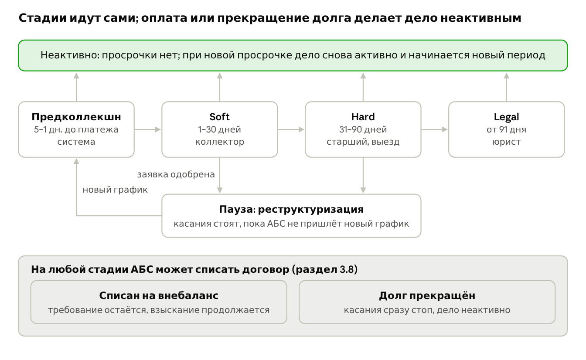

жизненный цикл дела · 4 стадии, пауза, неактивно, списание

Ночной пересчёт переводит дело на следующую стадию, как только просрочка переходит границу из стратегии. Пауза включается одобренной заявкой (снимается, когда АБС присылает новый график) или остановкой взыскания с причиной (раздел 3.6). На стадию Legal уходит не всё дело, а конкретный договор — правила в разделе 3.7.

Списание договора — не стадия, а решение организации, которое приходит из АБС на любой стадии: при списании на внебаланс взыскание продолжается на той же стадии, при прекращении долга касания по договору сразу останавливаются (раздел 3.8).

### 4.2 Пошагово

| №   | Когда                   | Кто                                | Что происходит                                                                                                                                         | Экран                                 |
|-----|-------------------------|------------------------------------|--------------------------------------------------------------------------------------------------------------------------------------------------------|---------------------------------------|
| 1   | По расписанию обмена    | Адаптер                            | Забирает из АБС клиентов, договоры, графики, задолженность и платежи; новые платежи сразу сверяет с делами                                             | Э-10                                  |
| 2   | Каждую ночь             | Система                            | Пересчитывает дни просрочки и стадии, сводит договоры клиента в дело, назначает стратегию и ответственного, строит очереди на завтра                   | —                                     |
| 3   | За 5–1 день до платежа  | Система                            | Предколлекшн: SMS со ссылкой на страницу оплаты                                                                                                        | Э-13                                  |
| 4   | В любой момент          | Должник                            | Оплачивает по ссылке, указывает дату оплаты или просит отсрочку                                                                                        | Э-13                                  |
| 5   | С 1-го дня просрочки    | Система                            | Soft: SMS и автообзвон по шагам стратегии; дело попадает в очередь коллектора                                                                          | Э-08                                  |
| 6   | Рабочий день            | Коллектор                          | Берёт следующее дело; модуль проверяет оплаты и лимиты и только потом даёт позвонить                                                                   | Э-02                                  |
| 7   | После контакта          | Коллектор                          | Фиксирует результат по правилам раздела 3.3                                                                                                            | Э-02, Э-03                            |
| 8   | В дату обещания         | Система                            | Проверяет оплату и меняет статус обещания по правилам раздела 3.4                                                                                      | —                                     |
| 9   | По заявке               | Руководитель, затем АБС            | Согласование и проведение реструктуризации, касания на паузе                                                                                           | Э-05                                  |
| 10  | Постоянно               | Руководитель                       | Следит за портфелем и KPI, переназначает дела                                                                                                          | Э-04, Э-06, Э-07                      |
| 11  | С 31-го дня             | Старший и выездной коллектор       | Hard: звонки поручителям, выезды с геометкой, фото и результатом                                                                                       | Э-02; выезды — в мобильном приложении |
| 12  | С 45-го дня             | Система                            | Досудебное уведомление: письмо и SMS о том, что после порога стратегии (по умолчанию 91-й день) долг может быть передан юристу для взыскания через суд | Э-08                                  |
| 13  | С 91-го дня по договору | Система или коллектор, затем юрист | Договор уходит юристу автоматически или кнопкой коллектора (настройка стратегии), остальные остаются у коллектора; претензия, иск, суд, исполнение     | Э-09                                  |
| 14  | При поступлении оплаты  | Система                            | Пересчёт задолженности; при просрочке 0 касания сразу останавливаются, через 3 дня без просрочки период закрывается и дело становится неактивным       | —                                     |

### 4.3 Работа с делом в очереди

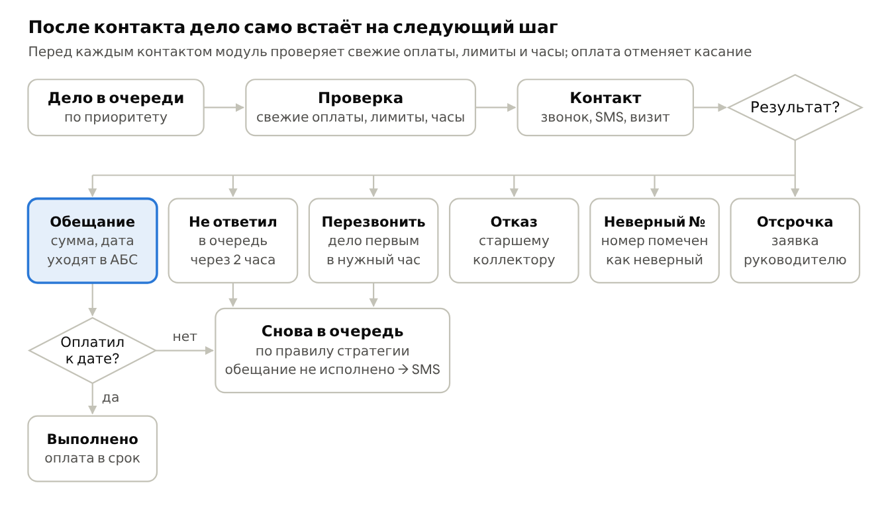

работа с делом в очереди · 6 результатов контакта

Коллектор не выбирает, что делать дальше: результат контакта сам ставит дело на следующий шаг. Отказ и неверный номер уводят дело из личной очереди — к старшему коллектору или на поиск контактов. Заявка на отсрочку дело из очереди не убирает: касания встают на паузу, только когда заявку одобрят на Э-05.

### 4.4 Реструктуризация

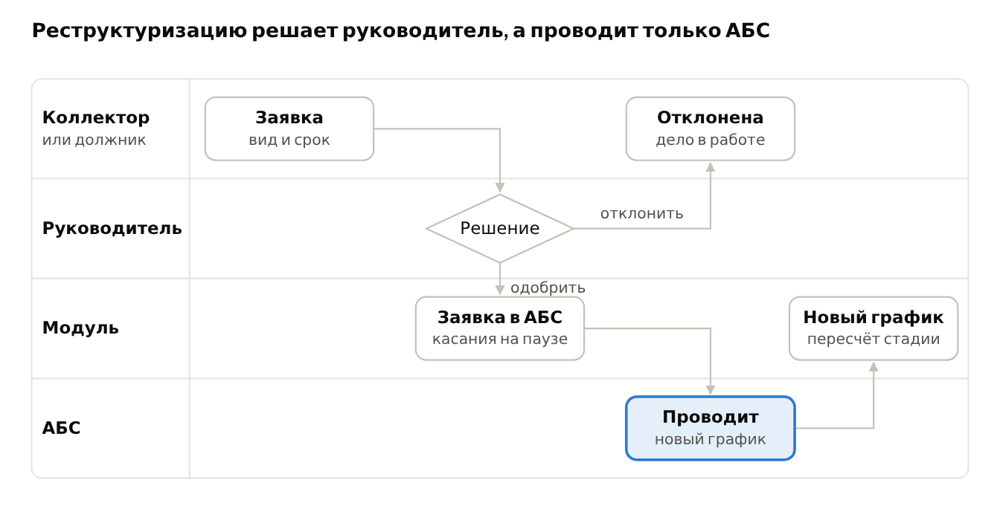

заявка на реструктуризацию · 4 участника

Заявку создаёт коллектор из краткой карточки (Э-02) или карточки должника (Э-03) либо должник со страницы оплаты (Э-13); решение — на экране согласований (Э-05). Если АБС отказала в проведении, заявка получает статус «Отклонена АБС», пауза снимается, и дело возвращается к стратегии.

### 4.5 Неактивное дело, периоды просрочки и хранение истории

Дело у клиента одно и не закрывается. Пока есть просрочка, оно активно; когда просрочка погашена и не вернулась за 3 дня, закрывается текущий период просрочки, а дело становится неактивным: уходит из очередей и ждёт. При новой просрочке по любому договору клиента то же дело снова активно и начинается следующий период — номер дела и вся история остаются. История контактов, обещаний и записей разговоров есть только в модуле, в АБС её нет: она нужна при повторной просрочке, жалобе должника, в суде и для отчётов.

**Когда период закрывается и дело становится неактивным**

| Итог периода     | Условие                                                                                                                                             | Что дальше                                                     |
|------------------|-----------------------------------------------------------------------------------------------------------------------------------------------------|----------------------------------------------------------------|
| Погашено         | АБС 3 дня подряд показывает просрочку 0 по всем договорам дела (число дней — настройка); если за это время просрочка вернулась, период продолжается | Дело неактивно; при новой просрочке — новый период             |
| Реструктуризация | АБС прислала новый график, просрочки по нему нет                                                                                                    | То же                                                          |
| Договоры закрыты | Все договоры дела закрыты в АБС: погашены полностью, в том числе досрочно                                                                           | Дело неактивно, пока у клиента нет новых договоров             |
| Долг прекращён   | По всем договорам дела с долгом АБС прислала статус «Долг прекращён» (раздел 3.8)                                                                   | Дело неактивно; напоминания по этим договорам больше не уходят |

Списание на внебаланс период не закрывает: требование к клиенту остаётся, и взыскание продолжается (раздел 3.8).

**Что происходит, когда дело становится неактивным**

- Запланированные звонки, SMS и шаги стратегии отменяются уже в момент, когда просрочка стала нулевой, не дожидаясь закрытия периода: звонки заплатившему клиенту — главная причина жалоб. Остаются только напоминания перед следующими платежами.

- Открытые обещания получают статус «Выполнено», если долг погашен, иначе «Отменено».

- Дело пропадает из Э-02 и из списка по умолчанию на Э-04 (там его находит фильтр «Неактивные»). Из поиска оно открывается на Э-03 только для чтения: плашка «Просрочки нет с …», кнопок звонка, сообщения и обещания нет.

- В журнал аудита (Э-12) пишется итог периода и кто или что его установило: АБС или система.

**Новая просрочка.** Ночной пересчёт снова делает дело активным: начинается следующий период, дело возвращается в очередь своей стадии. В шапке дела и на Э-02 появляется метка «2-й период просрочки» (3-й и так далее), а стратегия (Э-08) может вести повторных должников по своему сценарию — по условию «Номер периода». Ответственный по умолчанию прежний, если он ещё работает на этой стадии.

**Напоминание до платежа.** Предколлекшн — это напоминание системы, а не работа с делом: за 5–1 день до платежа SMS уходит и по неактивному делу. Дело при этом не становится активным, не попадает в очереди, и период просрочки не открывается. На Э-04 такие дела видны в фильтре стадии «Предколлекшн».

**Периоды просрочки.** Модуль сам записывает каждый период: номер, начало и конец, максимум дней и стадию, ответственного, стратегию и её версию, вариант A/B, сколько собрано и итог. Касания, обещания и заявки привязаны к периоду. Отчёты и KPI — процент возврата, срок до погашения, работа коллектора и стратегии — считаются по периодам, а не по делу целиком.

**Сроки хранения.** Все сроки — настройки организации; значения ниже — предложение по умолчанию, их сверяют с юристом (раздел 11).

| Данные                                                       | Срок по умолчанию                                      | Что потом                                                                                                       |
|--------------------------------------------------------------|--------------------------------------------------------|-----------------------------------------------------------------------------------------------------------------|
| Касания, обещания, комментарии и документы закрытых периодов | 12 месяцев после конца периода в рабочей базе          | Переносятся в архив: не нагружают очереди, находятся поиском                                                    |
| Архив, журнал аудита и само дело                             | 5 лет после закрытия последнего договора клиента в АБС | Обезличивание: ФИО, ИНН, телефоны, адреса и ссылки удаляются; суммы, даты и итоги периодов остаются для отчётов |
| Записи разговоров                                            | 12 месяцев после звонка                                | Удаляются; пока договор клиента у юриста или стоит отметка «Не удалять», записи хранятся                        |

Если по делу есть жалоба, суд или запрос регулятора, сотрудник с полным доступом к «Делам группы» ставит в карточке (Э-03) отметку «Не удалять» — в том числе на неактивном деле. Пока она стоит, ничего по делу не удаляется и не обезличивается; установка и снятие отметки пишутся в журнал аудита.

**Чьи это данные.** Владелец персональных данных — банк или МФО. Модуль стоит на серверах организации, и все данные хранятся у неё; наша команда получает доступ к серверу только для внедрения и поддержки, по договору с организацией. Персональные данные в КР регулирует Цифровой кодекс (с февраля 2026), с октября 2026 действуют штрафы за нарушения при обработке — до 65–140 тыс. сом для юрлиц ([economist.kg](https://economist.kg/vlast/2026/10/13/personalnye-dannye-shtrafy-140-tys-2/)).

**Критерии приёмки**

- [ ] После того как АБС прислала оплату, запланированные касания по делу отменяются при ближайшем обмене.

- [ ] Неактивное дело нельзя изменить, кроме отметки «Не удалять», но можно открыть из поиска и фильтра «Неактивные» на Э-04.

- [ ] Новая просрочка по любому договору клиента делает то же дело активным и открывает новый период; номер дела не меняется.

- [ ] Отчёты Э-06 и Э-07 считают процент возврата и срок до погашения по периодам просрочки.

- [ ] Дело с отметкой «Не удалять» не архивируется, не удаляется и не обезличивается.

## 5. Карта экранов и навигация

В этом ТЗ 13 экранов: 12 в веб-приложении и страница должника. Мобильное приложение выездного коллектора — отдельное ТЗ; два его макета (М-1, М-2) показаны в разделе 7.6, чтобы был виден стык с модулем. Все макеты лежат на [холсте](https://claude.ai/artifact/Lhkz9LeumcVWEr44bLCGQZ) в дизайн-системе «ЛБ Ломбард»; данные на них условные.

| №    | Экран              | Кто обычно работает                            | Главное на экране                                              |
|------|--------------------|------------------------------------------------|----------------------------------------------------------------|
| Э-01 | Вход               | Все сотрудники                                 | Логин, пароль, код из SMS по настройке организации             |
| Э-02 | Мои дела           | Коллектор, старший коллектор                   | Очередь на день и краткая карточка со всеми действиями         |
| Э-03 | Карточка должника  | Коллектор, руководитель, юрист                 | Все договоры, график, история, контакты, обещания, залог       |
| Э-04 | Дела группы        | Руководитель                                   | Все дела группы, фильтры, массовое переназначение              |
| Э-05 | Согласования       | Руководитель                                   | Заявки на отсрочку, новый график и списание пени               |
| Э-06 | Дашборд            | Руководитель, администратор стратегий          | Портфель по стадиям, сборы, KPI коллекторов                    |
| Э-07 | Отчёты             | Руководитель, администратор стратегий, аудитор | Готовые отчёты, выгрузка в Excel и PDF, рассылка по расписанию |
| Э-08 | Стратегии          | Руководитель, администратор стратегий          | Сегменты, шаги по дням, ограничения контактов, шаблоны         |
| Э-09 | Юридическая стадия | Юрист, руководитель                            | Реестр дел 91+ дней, документы, этапы суда                     |
| Э-10 | Интеграции         | Администратор системы                          | Подключение к АБС, сопоставление полей, журнал обмена          |
| Э-11 | Пользователи       | Администратор системы                          | Сотрудники, роли, филиалы, группы, планы                       |
| Э-12 | Журнал аудита      | Администратор системы, аудитор                 | Все действия с фильтрами и «было → стало»                      |
| Э-13 | Страница должника  | Должник                                        | Сумма, оплата, дата оплаты, просьба об отсрочке                |

**Навигация.** Боковое меню одно на всё веб-приложение: одиннадцать вкладок в разделах «Работа», «Аналитика», «Система» (таблица ниже). Любую вкладку можно открыть любой роли; какие из них видит сотрудник, решает администратор в матрице доступов на Э-11. Вкладка, закрытая для всех ролей сотрудника, в меню не показывается; у сотрудника с несколькими ролями доступы складываются. После установки все вкладки открыты всем ролям, аудитору — только просмотр. Логотип ведёт на главный экран основной роли. Внизу меню — дата опер. дня (подсвечивается, если обмен с АБС задержался) и профиль с выбором языка и выходом.

| Раздел меню | Вкладка            | Экран                                       |
|-------------|--------------------|---------------------------------------------|
| Работа      | Мои дела, Обещания | Э-02 («Обещания» — тот же экран с фильтром) |
| Работа      | Дела группы        | Э-04                                        |
| Работа      | Согласования       | Э-05                                        |
| Работа      | Юридическая стадия | Э-09                                        |
| Аналитика   | Дашборд            | Э-06                                        |
| Аналитика   | Отчёты             | Э-07                                        |
| Система     | Стратегии          | Э-08                                        |
| Система     | Интеграции         | Э-10                                        |
| Система     | Пользователи       | Э-11                                        |
| Система     | Журнал аудита      | Э-12                                        |

**Общие правила интерфейса:**

- На экране одна синяя кнопка — главное действие; остальные белые с рамкой.

- Действие, на которое у роли нет права, не показывается; временно недоступное — серое с причиной в подсказке.

- Клавиши: / — поиск, Ctrl+K — быстрый поиск с любого экрана, Enter — открыть, Esc — закрыть панель; у коллектора N — следующее дело.

- Суммы — моноширинным шрифтом с двумя знаками после запятой и пробелом между тысячами: 12 400,00.

- Минимальная ширина — 1024 px (планшет в альбомной ориентации); на узком экране меню сворачивается до иконок.

- Уведомления — колокольчик с счётчиком у профиля внизу меню: решение по заявке, напоминания юристу, низкий баланс связи, ошибки обмена с АБС, переназначенные дела. По настройке профиля дублируются на почту.

## 6. Экраны

По каждому экрану: макет, что делает каждый элемент, состояния и ошибки, проверки ввода и критерии приёмки. Порядок элементов в таблицах — как на макете, сверху вниз.

### Э-01 Вход

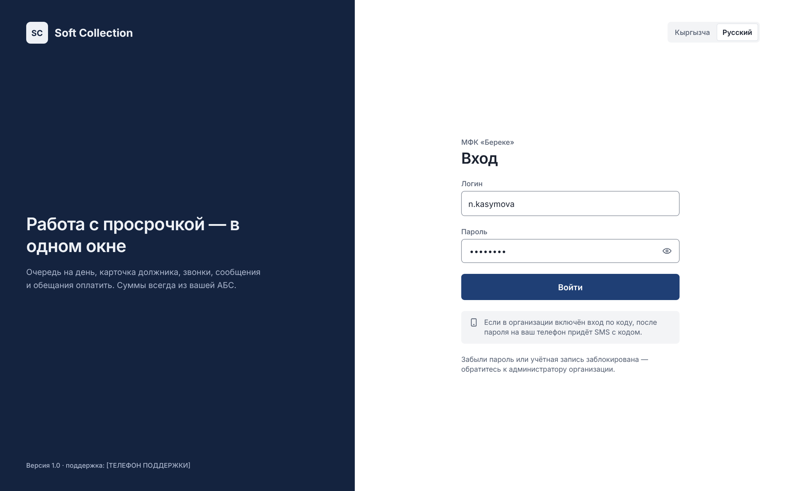

Сотрудник входит по логину и паролю во внутренней сети организации.

| Элемент                     | Поведение                                                                                                                                                                                                                      |
|-----------------------------|--------------------------------------------------------------------------------------------------------------------------------------------------------------------------------------------------------------------------------|
| Кыргызча, Русский           | Язык экрана входа; после входа язык берётся из профиля                                                                                                                                                                         |
| Логин                       | Латиница, цифры и точка, без учёта регистра                                                                                                                                                                                    |
| Пароль                      | Скрыт; кнопка-глаз показывает введённое                                                                                                                                                                                        |
| Войти                       | Проверяет пару; если в организации включён вход по коду, открывает второй шаг: 6 цифр из SMS, код живёт 5 минут, повторная отправка через 60 секунд                                                                            |
| Вход через Active Directory | Этап 3, включается в настройках организации: логин и пароль проверяются в корпоративном каталоге (Active Directory / LDAP); сотрудник, заблокированный в каталоге, войти не может. Роли и доступы по-прежнему выдаются на Э-11 |
| Подсказка о пароле          | Сброс делает администратор на Э-11; самостоятельного сброса в первой версии нет; при входе через Active Directory пароль меняют в каталоге организации                                                                         |

**Состояния и ошибки**

- Неверный логин или пароль — одно общее сообщение, без уточнения, что именно неверно.

- 5 неверных попыток подряд — блокировка входа на 15 минут.

- Учётная запись заблокирована — «Обратитесь к администратору организации».

- Первый вход и вход после сброса — обязательная смена пароля: от 8 символов, буквы и цифры.

- 30 минут бездействия — выход из системы (настройка организации).

**Критерии приёмки**

- [ ] После входа сотрудник попадает на главный экран основной роли из матрицы; по умолчанию коллектор — на Э-02, руководитель — на Э-06, администратор системы — на Э-10.

- [ ] Каждая попытка входа, успешная и неудачная, пишется в журнал аудита с IP-адресом.

- [ ] После 5 ошибок подряд вход блокируется на 15 минут.

### Э-02 Мои дела — рабочее место коллектора

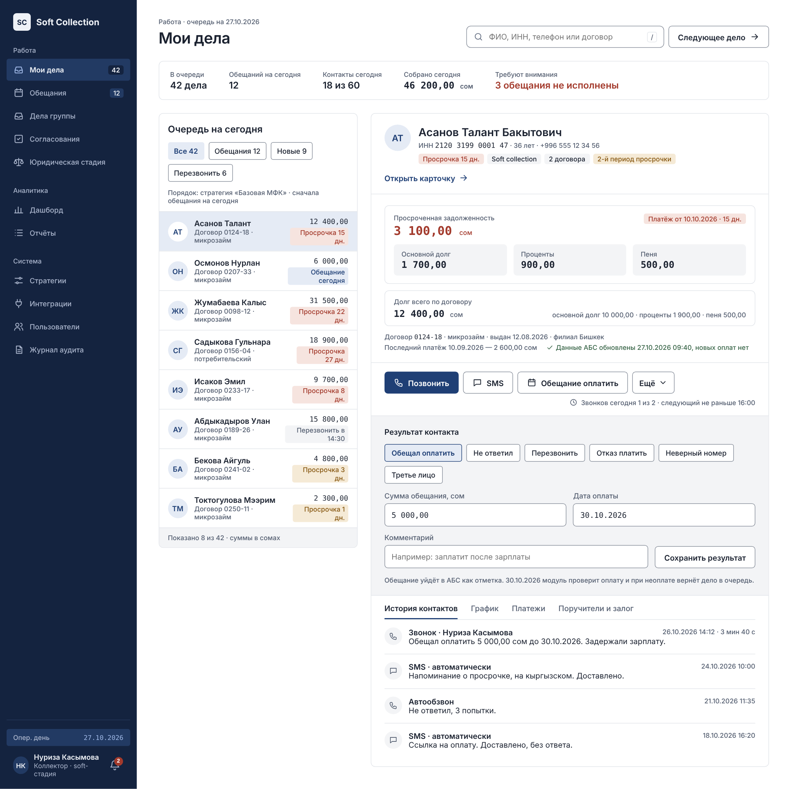

Коллектор проводит здесь весь день: слева очередь на сегодня, справа краткая карточка выбранного должника со всеми действиями. Уходить с экрана не нужно.

| Элемент                        | Поведение                                                                                                                                                                                                     |
|--------------------------------|---------------------------------------------------------------------------------------------------------------------------------------------------------------------------------------------------------------|
| Поиск                          | По ФИО, ИНН, телефону или номеру договора, тип запроса определяется сам; только среди дел, доступных роли                                                                                                     |
| Следующее дело                 | Открывает дело с наивысшим приоритетом стратегии; первыми идут обещания на сегодня и перезвоны на текущее время                                                                                               |
| Итоги дня                      | В очереди, обещаний на сегодня, контакты сегодня из дневного плана, собрано сегодня                                                                                                                           |
| Требуют внимания               | Число нарушенных обещаний; клик фильтрует по ним очередь                                                                                                                                                      |
| Фильтры очереди                | Все, Обещания, Новые, Перезвонить — с числом дел; подпись над списком называет стратегию сортировки                                                                                                           |
| Строка дела                    | ФИО, договор, продукт, сумма просрочки и статус: дни просрочки, обещание на сегодня или время перезвона                                                                                                       |
| Шапка карточки                 | ФИО, ИНН, возраст, основной телефон, стадия, число договоров, метка «N-й период» у повторной просрочки; «Открыть карточку» ведёт на Э-03                                                                      |
| Просроченная задолженность     | Сколько получить сейчас: основной долг, проценты, пеня. Только чтение, из АБС                                                                                                                                 |
| Долг всего по договору         | Весь остаток с составом. Только чтение                                                                                                                                                                        |
| Отметка «Данные АБС обновлены» | Время последних данных и были ли новые оплаты; новая оплата видна до звонка                                                                                                                                   |
| Позвонить                      | Звонок на основной номер через IP-телефонию с записью; перед звонком проверка оплат и лимитов                                                                                                                 |
| SMS                            | Список шаблонов; данные клиента подставляются сами, язык — по анкете; перед отправкой виден итоговый текст; ссылка на Э-13 добавляется в текст                                                                |
| Обещание оплатить              | Выбирает результат «Обещал оплатить» и ставит курсор в поле суммы                                                                                                                                             |
| Ещё                            | Заявка на реструктуризацию, добавить телефон, назначить перезвон, передать руководителю (дело получает метку «Нужна помощь руководителя» и видно ему на Э-04), передать юристу (в ручном режиме, с 91-го дня) |
| Счётчик звонков                | «Звонков сегодня 1 из 2 · следующий не раньше 16:00»                                                                                                                                                          |
| Результат контакта             | 6 вариантов из раздела 3.3; набор полей зависит от выбранного                                                                                                                                                 |
| Сохранить результат            | Пишет результат в историю, обещание — в АБС, убирает дело из очереди до следующего шага стратегии                                                                                                             |
| Вкладки карточки               | История контактов (новые сверху), График, Платежи, Поручители и залог                                                                                                                                         |

**Состояния и ошибки**

- Идёт звонок: «Позвонить» превращается в «Завершить» с таймером; следующее дело нельзя взять, пока не сохранён результат звонка.

- Оплата пришла, пока карточка открыта: плашка «Пришла оплата 3 100,00 в 10:12», кнопки контакта серые до пересчёта.

- Вне разрешённых часов или сверх лимита: «Позвонить» и «SMS» серые с причиной в подсказке.

- Телефония недоступна: кнопка серая «Телефония недоступна», результат можно отметить вручную.

- Очередь пуста: «На сегодня дел нет» и сумма собранного за день.

- У клиента есть договор у юриста — он не входит в «Просроченную задолженность», в шапке метка «1 договор у юриста».

**Проверки ввода**

- Обещание: сумма больше нуля и не больше всей задолженности, дата — от сегодня до +14 дней.

- Перезвонить: дата и время только в разрешённые часы.

- Комментарий: до 1 000 символов; для «Отказ платить» и «Третье лицо» обязателен.

**Критерии приёмки**

- [ ] Путь от открытия дела до сохранения результата не требует перехода на другой экран.

- [ ] Краткая карточка открывается не дольше 2 секунд.

- [ ] Звонок и сообщение невозможны вне разрешённых часов и сверх лимита, причина видна в подсказке.

- [ ] Сохранённое обещание появляется в АБС при ближайшем обмене.

- [ ] Клиенту, у которого перед звонком нашлась свежая оплата, звонок не выполняется.

### Э-03 Карточка должника

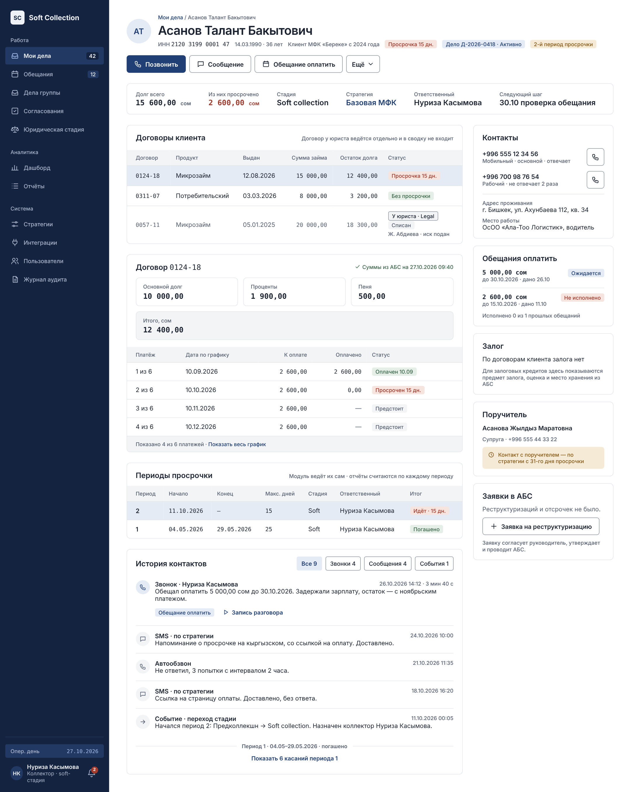

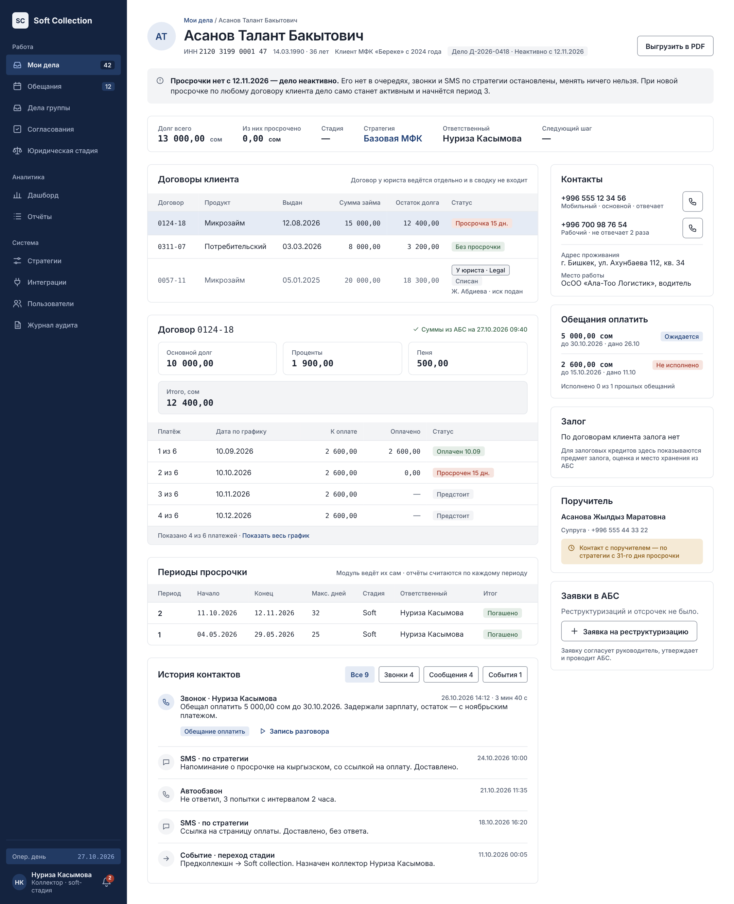

Всё о клиенте на одной странице: договоры, график, история, контакты, обещания и залог. Нужна перед сложным разговором, при передаче дела и юристу.

| Элемент                                 | Поведение                                                                                                                                                                                                                                                                                                                        |
|-----------------------------------------|----------------------------------------------------------------------------------------------------------------------------------------------------------------------------------------------------------------------------------------------------------------------------------------------------------------------------------|
| Путь над именем                         | Возвращает туда, откуда открыта карточка: к очереди на то же дело, к «Делам группы», «Согласованиям» или поиску                                                                                                                                                                                                                  |
| Статус дела                             | Номер дела и статус: «Активно» или «Неактивно с \<дата\>»; у повторной просрочки — метка «N-й период просрочки»                                                                                                                                                                                                                  |
| Позвонить, Сообщение, Обещание оплатить | Как на Э-02; «Сообщение» открывает выбор шаблона SMS                                                                                                                                                                                                                                                                             |
| Ещё                                     | Назначить перезвон, назначить выезд, выгрузить карточку в PDF; при полном доступе к «Делам группы» — сменить ответственного, поставить отметку «Не удалять» и остановить взыскание с причиной (раздел 3.6); «Передать юристу» — выбор договора и обязательный комментарий, доступно в ручном режиме с 91-го дня просрочки        |
| Сводка                                  | Долг, просрочено, стадия, ответственный, следующий шаг стратегии. Только чтение                                                                                                                                                                                                                                                  |
| Стратегия                               | Ссылка открывает стратегию дела на Э-08                                                                                                                                                                                                                                                                                          |
| Договоры клиента                        | Все договоры клиента; договор у юриста — серая строка с меткой «У юриста» и именем юриста; списанный на внебаланс — с меткой «Списан», работа по нему идёт дальше; договор с прекращённым долгом — серая строка «Долг прекращён» без действий (раздел 3.8). Клик по строке показывает ниже задолженность и график этого договора |
| Блок договора                           | Основной долг, проценты, пеня, итого — из АБС, с датой обновления                                                                                                                                                                                                                                                                |
| График платежей                         | Плановые платежи со статусом: оплачен, просрочен, предстоит; «Показать весь график» раскрывает все строки                                                                                                                                                                                                                        |
| Периоды просрочки                       | Все периоды дела: номер, начало, конец, максимум дней, стадия, ответственный, итог; текущий подсвечен. Только чтение                                                                                                                                                                                                             |
| История контактов                       | Фильтры: Все, Звонки, Сообщения, События; запись разговора проигрывается прямо в карточке; история идёт подряд по всему делу, прошлые периоды свёрнуты под разделителем «Период N · итог»                                                                                                                                        |
| Телефоны                                | Кнопка звонка у каждого номера и его статус: отвечает, не отвечает, неверный                                                                                                                                                                                                                                                     |
| Адрес, место работы                     | Из АБС; адрес передаётся в мобильное приложение для выезда                                                                                                                                                                                                                                                                       |
| Обещания оплатить                       | Текущие и прошлые со статусом; итог «выполнено 2 из 3»                                                                                                                                                                                                                                                                           |
| Залог                                   | Описание, оценка и место хранения. Только чтение                                                                                                                                                                                                                                                                                 |
| Поручитель                              | Контакты; кнопка звонка появляется только со стадии, которую разрешает стратегия                                                                                                                                                                                                                                                 |
| Заявка на реструктуризацию              | Форма: договор (если их несколько), вид (отсрочка, новый график, списание пени), срок, причина. Уходит на Э-05 руководителю группы, а если автор — сам руководитель, второму согласующему                                                                                                                                        |
| Заявки в АБС                            | Все заявки клиента на отсрочку, новый график и списание пени: вид, дата, статус (ждёт решения, в АБС, проведена, отклонена); если заявок не было — так и пишется                                                                                                                                                                 |

**Состояния и ошибки**

- Договоры в сомах и долларах — суммы показываются отдельными строками, без пересчёта.

- Дело на паузе — плашка «Касания на паузе до нового графика из АБС»; ручной звонок доступен.

- Дело неактивно — плашка «Просрочки нет с \<дата\>»; кнопок «Позвонить», «Сообщение», «Обещание оплатить» и «Заявка» нет, карточку можно только смотреть и выгрузить в PDF.

- Данным АБС больше суток — жёлтая плашка с датой последнего обмена.

- Залога по договорам нет — блок «Залог» так и пишет; для залоговых кредитов там предмет залога, оценка и место хранения из АБС.

- У роли включено маскирование в матрице — ФИО и телефоны маскируются; без права «Слушать записи разговоров» запись в истории не проигрывается.

- Договор у юриста — звонок, сообщение, обещание и заявка по нему коллектору недоступны; его суммы не входят в сводку.

**Проверки ввода**

- Заявка: вид и причина обязательны, срок отсрочки — от 1 до 90 дней (настройка), причина — до 1 000 символов.

- На деле не может быть двух открытых заявок; вторая кнопка серая с причиной.

**Критерии приёмки**

- [ ] Видны все договоры клиента; суммы совпадают с АБС на дату обновления.

- [ ] Запись разговора проигрывается без скачивания файла.

- [ ] Звонок поручителю недоступен до стадии, разрешённой стратегией.

- [ ] Каждый просмотр карточки пишется в журнал аудита.

- [ ] Коллектор не может создать обещание или заявку по договору у юриста.

- [ ] В ручном режиме «Передать юристу» до 91-го дня серая с причиной; после передачи договор сразу появляется на Э-09.

- [ ] Неактивное дело открывается только для чтения; после новой просрочки и ночного пересчёта то же дело снова активно, а в блоке «Периоды просрочки» появляется новый период.

### Э-04 Дела группы

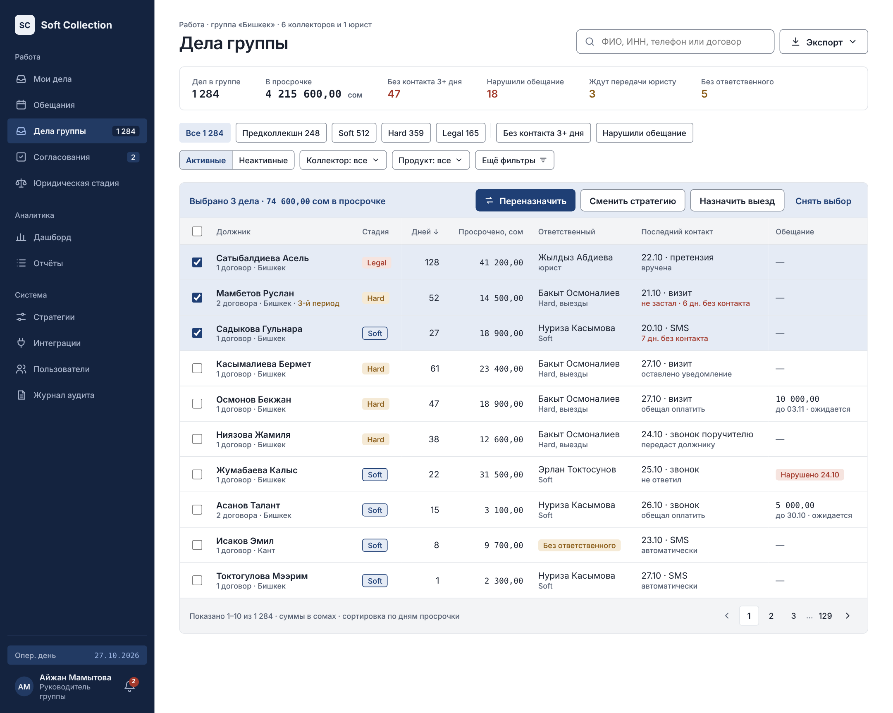

Руководитель видит все дела своей группы, находит застрявшие и перераспределяет их пачкой.

| Элемент                         | Поведение                                                                                                                                                                                                        |
|---------------------------------|------------------------------------------------------------------------------------------------------------------------------------------------------------------------------------------------------------------|
| Поиск                           | ФИО, ИНН, телефон или номер договора                                                                                                                                                                             |
| Экспорт                         | Текущий отфильтрованный список в Excel или PDF                                                                                                                                                                   |
| Итоги                           | Дел в группе, в просрочке, без контакта 3+ дня, нарушили обещание, ждут передачи юристу, без ответственного; каждая цифра работает как фильтр                                                                    |
| Фильтры стадий                  | Все, Предколлекшн, Soft, Hard, Legal с числом дел; в Legal — договоры клиентов группы, переданные юристу, строка открывает юридическое дело на Э-09; быстрые фильтры «Без контакта 3+ дня» и «Нарушили обещание» |
| Активные / Неактивные           | Статус дела; по умолчанию — Активные. Неактивные дела открываются только для чтения и в итоги сверху не входят                                                                                                   |
| Коллектор, Продукт, Ещё фильтры | Ответственный, продукт, филиал, сумма, дни просрочки, наличие залога, язык клиента                                                                                                                               |
| Флажки                          | Выбор строк на странице; в шапке — все на странице, с предложением выбрать все дела по фильтру                                                                                                                   |
| Панель выбора                   | Число и сумма выбранных дел; Переназначить, Сменить стратегию, Назначить выезд, Снять выбор                                                                                                                      |
| Переназначить                   | Окно: новый ответственный и причина (отпуск, нагрузка, эскалация, другое). Дела сразу появляются в очереди нового сотрудника                                                                                     |
| Сменить стратегию               | Только на стратегию, сегмент которой подходит делам; действует со следующего ночного пересчёта                                                                                                                   |
| Назначить выезд                 | Создаёт визит выездному коллектору на выбранную дату с адресом из АБС                                                                                                                                            |
| Таблица                         | Должник, стадия, дни, просрочено, ответственный, последний контакт, обещание. Клик по заголовку — сортировка, по строке — Э-03                                                                                   |
| Страницы                        | 10, 20 или 50 строк на странице                                                                                                                                                                                  |

**Состояния и ошибки**

- «Без ответственного» — дело, для которого правила распределения не нашли сотрудника, или дело заблокированного сотрудника; такие дела видны в итогах.

- Дело без контакта дольше 3 дней — красная подпись в колонке «Последний контакт».

**Проверки ввода**

- В списке «Кому переназначить» только сотрудники с правом на стадию и филиал всех выбранных дел.

- Причина переназначения обязательна.

**Критерии приёмки**

- [ ] Переназначение 500 дел одной операцией занимает не больше 10 секунд.

- [ ] Новый ответственный видит дела в очереди сразу после переназначения.

- [ ] Каждое переназначение пишется в журнал аудита с причиной.

### Э-05 Согласования

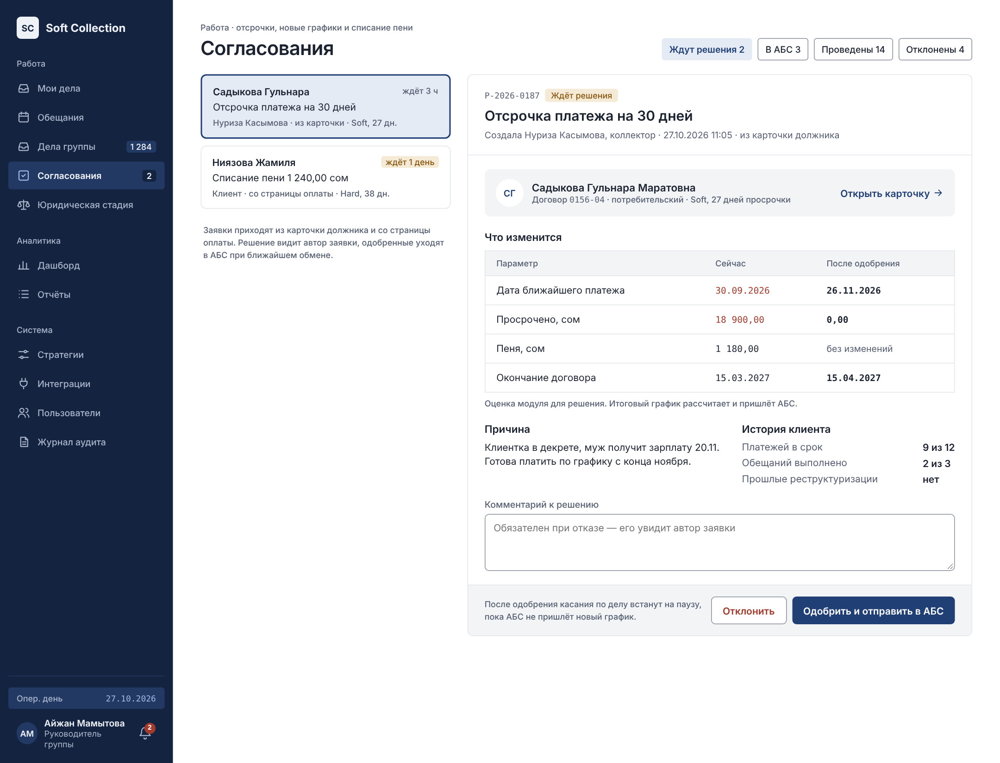

Руководитель решает по каждой заявке на одном экране и видит, что изменится для клиента после одобрения.

| Элемент                    | Поведение                                                                                                                    |
|----------------------------|------------------------------------------------------------------------------------------------------------------------------|
| Статусы                    | Ждут решения, В АБС, Проведены, Отклонены — с числом заявок                                                                  |
| Заявка в списке            | Клиент, вид заявки, автор и источник (карточка или страница оплаты), стадия, сколько ждёт                                    |
| Шапка заявки               | Номер, статус, вид, автор, дата и источник                                                                                   |
| Клиент                     | ФИО, договор, продукт, стадия; «Открыть карточку» ведёт на Э-03                                                              |
| Что изменится              | Сейчас и после одобрения: дата платежа, просрочено, пеня, окончание договора. Это оценка модуля, итоговый график считает АБС |
| Причина                    | Текст автора заявки или клиента                                                                                              |
| История клиента            | Платежей в срок, обещаний выполнено, прошлые реструктуризации                                                                |
| Комментарий к решению      | Обязателен при отказе; его видит автор заявки                                                                                |
| Отклонить                  | Закрывает заявку, автор получает уведомление, касания по стратегии продолжаются                                              |
| Одобрить и отправить в АБС | Ставит касания на паузу и отправляет заявку в АБС при ближайшем обмене                                                       |

**Статусы заявки:** Ждёт решения → Одобрена → В АБС → Проведена; из «Ждёт решения» — Отклонена; из «В АБС» — Отклонена АБС (пауза снимается, дело возвращается к стратегии).

**Состояния и ошибки**

- Заявка ждёт дольше 1 рабочего дня — жёлтая метка в списке.

- Нет заявок — «Новых заявок нет» и ссылка на проведённые за неделю.

**Критерии приёмки**

- [ ] Отказ без комментария невозможен.

- [ ] Одобренная заявка уходит в АБС при ближайшем обмене и получает статус «В АБС».

- [ ] Пока заявка в АБС, автоматические касания по делу не выполняются.

- [ ] Заявки видны только по делам, которые роль видит по матрице; у руководителя по умолчанию — дела своей группы.

- [ ] Заявку, которую руководитель создал сам как коллектор, он видит без кнопок «Одобрить» и «Отклонить»; её решает второй согласующий группы.

### Э-06 Дашборд руководителя

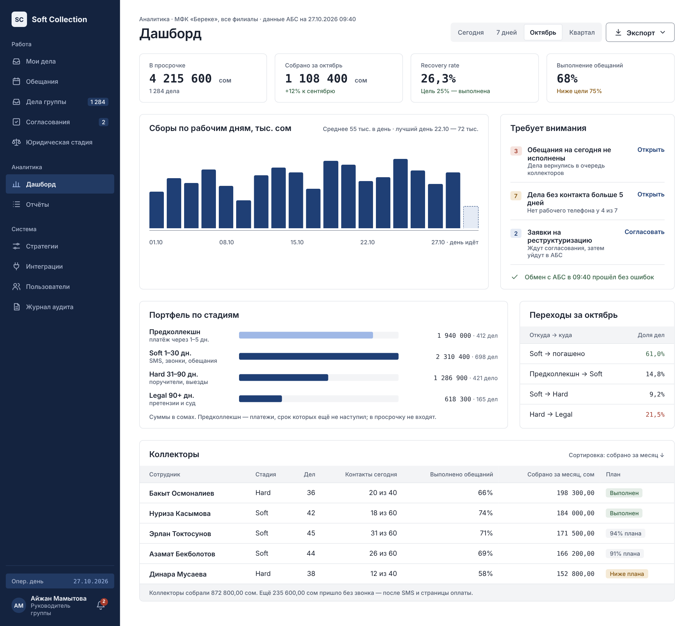

За минуту видно, сколько в просрочке, сколько собрано, где застревают дела и кто из коллекторов отстаёт. Любая цифра открывает Э-04 с фильтром по делам за ней.

| Элемент                         | Поведение                                                                                                            |
|---------------------------------|----------------------------------------------------------------------------------------------------------------------|
| Сегодня, 7 дней, Месяц, Квартал | Отчётный период для всех цифр экрана; можно выбрать свои даты. Не путать с периодом просрочки дела                   |
| Экспорт                         | Excel или PDF — то, что на экране, за выбранный период                                                               |
| В просрочке                     | Сумма и число дел в просрочке                                                                                        |
| Собрано за период               | Сумма оплат и рост к прошлому периоду                                                                                |
| Recovery rate                   | Доля собранного от просрочки на начало периода, рядом цель                                                           |
| Выполнение обещаний             | Доля обещаний, оплаченных в срок, рядом цель; ниже цели подсвечивается                                               |
| Сборы по рабочим дням           | Столбик на день, наведение показывает сумму, сегодня отмечено пунктиром                                              |
| Требует внимания                | «Открыть» — нарушенные обещания, дела без контакта и договоры, ждущие передачи юристу, на Э-04; «Согласовать» — Э-05 |
| Строка обмена с АБС             | Прошёл ли последний обмен; при ошибке — ссылка на журнал обмена Э-10                                                 |
| Портфель по стадиям             | Сумма и число дел на каждой стадии; клик — список дел стадии                                                         |
| Переходы за период              | Доля дел, ушедших на следующую стадию или погашенных; рост перехода в Legal подсвечивается                           |
| Таблица коллекторов             | Дела, контакты, выполнение обещаний, сборы, отметка плана; сортировка по заголовку, клик по строке — дела сотрудника |
| Строка под таблицей             | Сколько собрали коллекторы и сколько пришло без звонка — после SMS и страницы оплаты                                 |

| Показатель             | Как считается                                                                             |
|------------------------|-------------------------------------------------------------------------------------------|
| Recovery rate          | Собрано за отчётный период ÷ просроченная задолженность на его начало                     |
| Выполнение обещаний    | Обещания, оплаченные полностью в срок ÷ все обещания с датой в отчётном периоде           |
| Переход между стадиями | Дела, перешедшие со стадии на следующую за отчётный период ÷ дела на стадии на его начало |
| Выполнение плана       | Собрано сотрудником за месяц ÷ план из Э-11                                               |

**Критерии приёмки**

- [ ] Цифры дашборда совпадают с отчётами Э-07 за тот же период.

- [ ] Клик по плитке, стадии или сотруднику открывает Э-04 с тем же фильтром.

- [ ] Цифры обновляются после каждого обмена с АБС; время обновления видно на экране.

- [ ] Суммы в сомах и долларах не складываются.

### Э-07 Отчёты

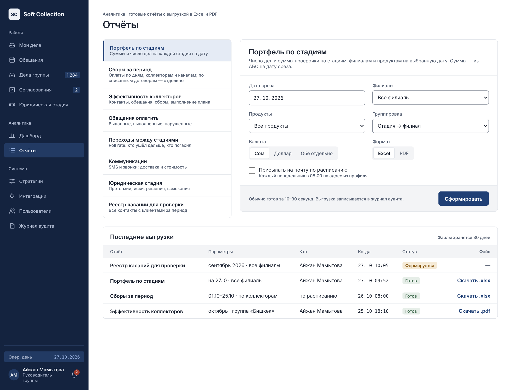

Готовые отчёты с параметрами, выгрузкой в Excel и PDF и рассылкой на почту по расписанию.

| Отчёт                       | Что внутри                                                                                                                                           |
|-----------------------------|------------------------------------------------------------------------------------------------------------------------------------------------------|
| Портфель по стадиям         | Число дел и суммы просрочки по стадиям, филиалам и продуктам на дату                                                                                 |
| Сборы за период             | Оплаты по дням, коллекторам и каналам: после звонка, после SMS, по странице оплаты, без касания; отдельной строкой — взыскано по списанным договорам |
| Эффективность коллекторов   | Контакты, обещания и их выполнение, сборы, выполнение плана                                                                                          |
| Обещания оплатить           | Выданные, выполненные полностью и частично, нарушенные                                                                                               |
| Переходы между стадиями     | Доля дел, перешедших дальше или погашенных, по месяцам                                                                                               |
| Коммуникации                | SMS и звонки: отправлено, доставлено, стоимость по тарифу                                                                                            |
| Юридическая стадия          | Претензии, иски, решения, суммы взыскания                                                                                                            |
| Реестр касаний для проверки | Все контакты с клиентами за период: кто, когда, канал, результат                                                                                     |

| Элемент                        | Поведение                                                                                                 |
|--------------------------------|-----------------------------------------------------------------------------------------------------------|
| Список отчётов                 | Выбор отчёта; справа его описание и параметры                                                             |
| Дата среза или период          | Для портфеля — дата, для остальных — период                                                               |
| Филиалы, Продукты, Группировка | Ограничены делами, которые роль видит по матрице: руководитель по умолчанию — только свою группу          |
| Валюта                         | Сом, доллар или обе отдельными блоками                                                                    |
| Формат                         | Excel или PDF                                                                                             |
| Присылать по расписанию        | День недели и время; файл приходит на почту из профиля                                                    |
| Сформировать                   | Ставит отчёт в очередь; статус виден в «Последних выгрузках»                                              |
| Последние выгрузки             | Отчёт, параметры, кто, когда, статус (Формируется, Готов, Ошибка), ссылка на файл; файлы хранятся 30 дней |

**Критерии приёмки**

- [ ] Отчёт до 100 000 строк формируется не дольше 2 минут.

- [ ] Каждая выгрузка пишется в журнал аудита.

- [ ] Отчёт по расписанию приходит на почту в указанное время.

- [ ] Цифры отчётов совпадают с дашбордом Э-06 за тот же период.

### Э-08 Стратегии

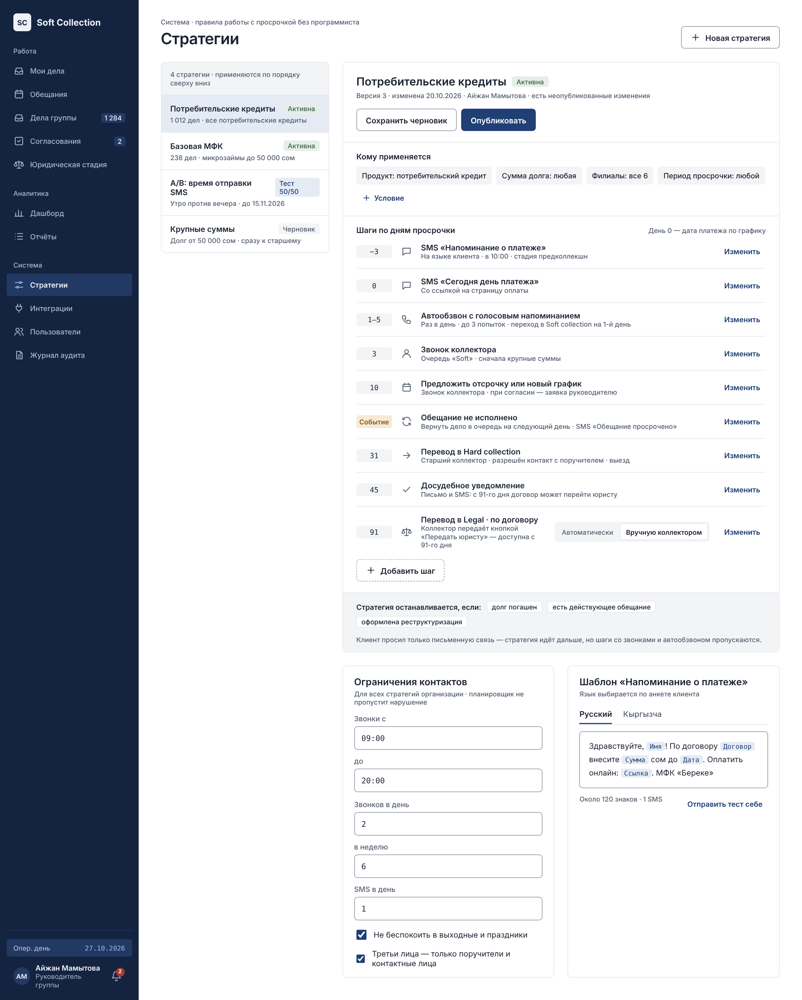

Здесь без программиста задаётся, что происходит с делом в каждый день просрочки: кому стратегия применяется, какие шаги и когда она останавливается.

| Элемент                              | Поведение                                                                                                                                                                                             |
|--------------------------------------|-------------------------------------------------------------------------------------------------------------------------------------------------------------------------------------------------------|
| Новая стратегия                      | Пустая стратегия или копия выбранной                                                                                                                                                                  |
| Строка стратегии                     | Открывает её справа; статус: активна, черновик, тест                                                                                                                                                  |
| Порядок в списке                     | Если дело подходит под несколько стратегий, применяется верхняя; порядок меняется перетаскиванием                                                                                                     |
| Тест 50/50                           | A/B-тест: подходящие дела случайно делятся пополам между двумя вариантами, результат виден на Э-06                                                                                                    |
| Версия                               | Кто и когда менял; прошлые версии сохраняются, к любой можно вернуться                                                                                                                                |
| Сохранить черновик                   | Сохраняет без применения к делам                                                                                                                                                                      |
| Опубликовать                         | Изменения применяются к делам при ближайшем ночном пересчёте                                                                                                                                          |
| Кому применяется                     | Условия сегмента: продукт, сумма долга, филиал, номер периода просрочки, договор списан; крестик удаляет условие                                                                                      |
| \+ Условие                           | Продукт, сумма, валюта, дни просрочки, филиал, язык клиента, наличие залога, номер периода просрочки (повторные должники), номер за рубежом                                                           |
| Шаг                                  | День или событие, канал, действие и детали: например, день 3 — звонок коллектора, очередь Soft                                                                                                        |
| Изменить шаг                         | День или событие, канал, шаблон, время, очередь, ответственная роль; у шага «Перевод в Legal» — режим передачи: автоматически или вручную коллектором                                                 |
| Добавить шаг                         | По дню просрочки или по событию: обещание не исполнено, клиент не отвечает 7 дней и другие                                                                                                            |
| Стратегия останавливается, если      | Долг погашен, есть действующее обещание, оформлена реструктуризация. Если клиент просил только письменную связь, стратегия не останавливается: шаги со звонками и автообзвоном пропускаются, SMS идут |
| Звонки с / до                        | Разрешённые часы; вне их «Позвонить» неактивна                                                                                                                                                        |
| Звонков в день, в неделю, SMS в день | Лимиты на одного клиента по всем каналам                                                                                                                                                              |
| Не беспокоить в выходные и праздники | Ни автоматических, ни ручных касаний в эти дни; календарь праздников КР ведёт администратор                                                                                                           |
| Третьи лица                          | Звонить можно только поручителям и контактным лицам                                                                                                                                                   |
| Шаблон: Русский, Кыргызча            | Две версии; клиент получает сообщение на языке анкеты                                                                                                                                                 |
| Переменные в тексте                  | {имя}, {договор}, {сумма}, {дата}, {ссылка} — подставляются при отправке                                                                                                                              |
| Счётчик знаков                       | Сколько SMS займёт сообщение с учётом кириллицы                                                                                                                                                       |
| Отправить тест себе                  | Пример с тестовыми данными на телефон сотрудника                                                                                                                                                      |

**Проверки ввода**

- Опубликовать нельзя стратегию без сегмента или без шагов; кнопка серая с причиной.

- Шаг с SMS или голосовым роботом требует шаблона на обоих языках.

- Лимиты — целые числа от 0; ноль запрещает канал.

**Критерии приёмки**

- [ ] Опубликованная версия применяется к делам при ближайшем ночном пересчёте; прошлую версию можно вернуть.

- [ ] Ограничения контактов действуют на все стратегии и на ручные действия коллектора.

- [ ] В A/B-тесте дела делятся случайно, а результаты вариантов видны на Э-06 раздельно.

- [ ] Любое изменение стратегии пишется в журнал аудита с «было → стало».

### Э-09 Юридическая стадия

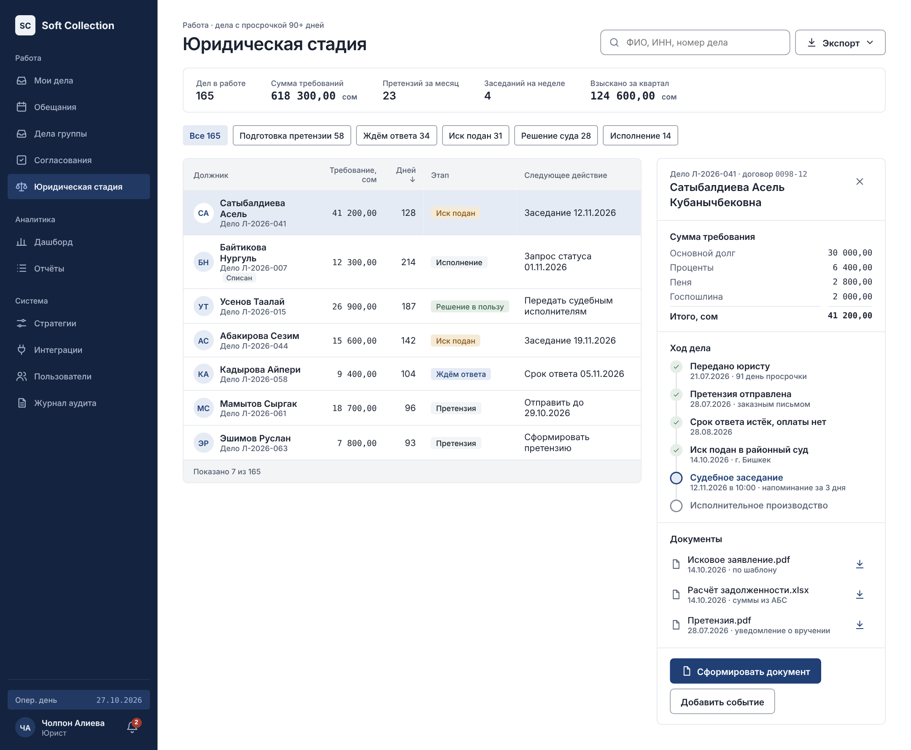

Рабочее место юриста: все договоры, переданные юристу (по умолчанию — с 91-го дня просрочки), каждый отдельным юридическим делом, с этапом и следующим действием. Документы формируются по шаблонам с суммами из АБС, сроки отслеживаются сами.

| Элемент               | Поведение                                                                                                                       |
|-----------------------|---------------------------------------------------------------------------------------------------------------------------------|
| Поиск                 | По ФИО, ИНН или номеру дела                                                                                                     |
| Экспорт               | Реестр дел в Excel или PDF — для отчёта руководству или проверки                                                                |
| Строка итогов         | Дел в работе, сумма требований, претензий за месяц, заседаний на неделе, взыскано за квартал                                    |
| Фильтры этапов        | Все, Подготовка претензии, Ждём ответа, Иск подан, Решение суда, Исполнение — с числом дел                                      |
| Строка дела           | Открывает панель дела справа, список остаётся на месте; у договора, списанного в АБС на внебаланс, — метка «Списан»             |
| Следующее действие    | Что и к какой дате сделать; просроченные сроки красные                                                                          |
| Закрыть (крестик)     | Закрывает панель                                                                                                                |
| Сумма требования      | Основной долг, проценты, пеня, госпошлина и итог — из АБС на дату расчёта                                                       |
| Ход дела              | Кто и когда передал договор (система или коллектор) и его комментарий, пройденные этапы с датами; текущий выделен               |
| Документы → скачать   | Претензия, иск или расчёт задолженности                                                                                         |
| Сформировать документ | Шаблон: претензия, исковое заявление, расчёт задолженности; данные и суммы подставляются, документ сохраняется в деле           |
| Добавить событие      | Дата заседания, решение суда, передача судебным исполнителям, поступление по исполнительному листу; можно поставить напоминание |

**Этапы дела:** Подготовка претензии → Ждём ответа → Иск подан → Решение суда → Исполнение → Закрыто.

**Критерии приёмки**

- [ ] Суммы в документах совпадают с АБС на дату расчёта, указанную в документе.

- [ ] Напоминание о заседании приходит юристу за 3 дня.

- [ ] Оплата по делу на юридической стадии видна в ходе дела и уменьшает сумму требования.

- [ ] Шаблоны документов редактирует на Э-09 сотрудник с полным доступом к «Юридической стадии», без участия разработчиков.

- [ ] Если у клиента есть договоры у коллектора, в панели дела видны их номера и имя ответственного коллектора.

### Э-10 Интеграции

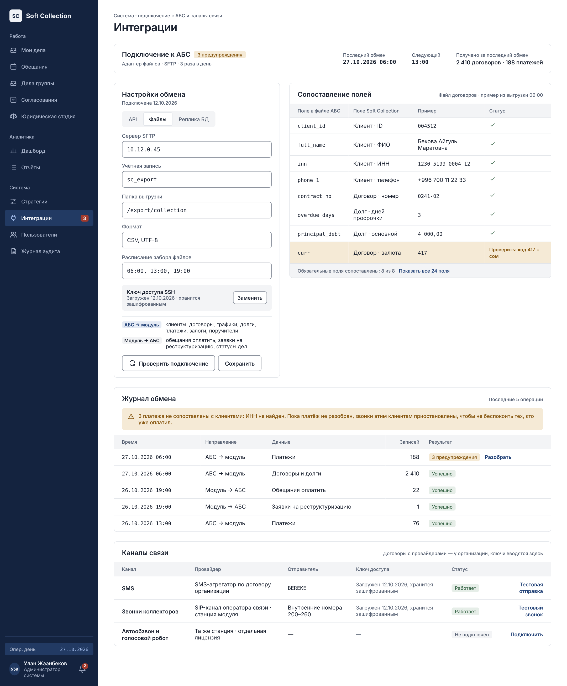

Экран администратора: подключение к АБС клиента, настройка обмена и разбор его ошибок. От него зависит, уложится ли внедрение в 2–4 недели.

| Элемент                               | Поведение                                                                                                                                                                                                                                                                                    |
|---------------------------------------|----------------------------------------------------------------------------------------------------------------------------------------------------------------------------------------------------------------------------------------------------------------------------------------------|
| Первое подключение                    | К модулю подключается одна АБС организации. Экран с первого дня такой же, как на макете: до подключения поля настроек и сопоставления пустые, статус вверху — «Не подключена». Администратор заполняет их здесь же, нажимает «Проверить подключение», затем «Сохранить» — и обмен начинается |
| Подключение к АБС (строка сверху)     | Тип адаптера и расписание, последний и следующий обмен, сколько договоров и платежей получено; статус: не подключена, работает, есть предупреждения, нет связи                                                                                                                               |
| API, Файлы, Реплика БД                | Тип адаптера; от него зависят поля ниже: адрес API и ключ, SFTP и папка или параметры базы                                                                                                                                                                                                   |
| Сервер, учётная запись, папка, формат | Где и в каком виде АБС отдаёт данные                                                                                                                                                                                                                                                         |
| Расписание                            | Когда забирать данные; для API — интервал в минутах или по событию                                                                                                                                                                                                                           |
| Ключ доступа → Заменить               | Загрузка нового ключа; сам ключ на экране не показывается, хранится зашифрованным                                                                                                                                                                                                            |
| АБС → модуль, модуль → АБС            | Какие данные в какую сторону идут. Только чтение                                                                                                                                                                                                                                             |
| Проверить подключение                 | Читает пробную порцию данных, ничего не загружая, и показывает, что не так                                                                                                                                                                                                                   |
| Сохранить                             | Настройки применяются со следующего обмена                                                                                                                                                                                                                                                   |
| Сопоставление полей                   | Для каждой колонки АБС — поле модуля из списка и пример значения из последней выгрузки; жёлтая строка — значение надо проверить                                                                                                                                                              |
| Показать все поля                     | Раскрывает необязательные поля сверх минимума                                                                                                                                                                                                                                                |
| Предупреждение сверху                 | Что пошло не так и как это влияет на работу: например, звонки клиентам с ненайденными платежами приостановлены                                                                                                                                                                               |
| Журнал обмена                         | Время, направление, данные, число записей и результат каждого обмена                                                                                                                                                                                                                         |
| Разобрать                             | Проблемные записи: каждую можно вручную сопоставить с клиентом или отклонить                                                                                                                                                                                                                 |
| Каналы связи                          | Для каждого канала — провайдер, ключ доступа, имя отправителя SMS, статус и тестовая отправка. При варианте «через нас» — баланс связи, пополнение, порог предупреждения и расход за месяц по каналам (раздел 7.5)                                                                           |

**Критерии приёмки**

- [ ] Обмен не включается, пока «Проверить подключение» не прошла успешно.

- [ ] Ключи и пароли доступа не видны ни на экране, ни в журналах.

- [ ] Ошибка обмена подсвечивает пункт меню красным счётчиком и строку на Э-06.

- [ ] Обязательные поля канонической модели (раздел 7.2) нельзя оставить без сопоставления.

### Э-11 Пользователи

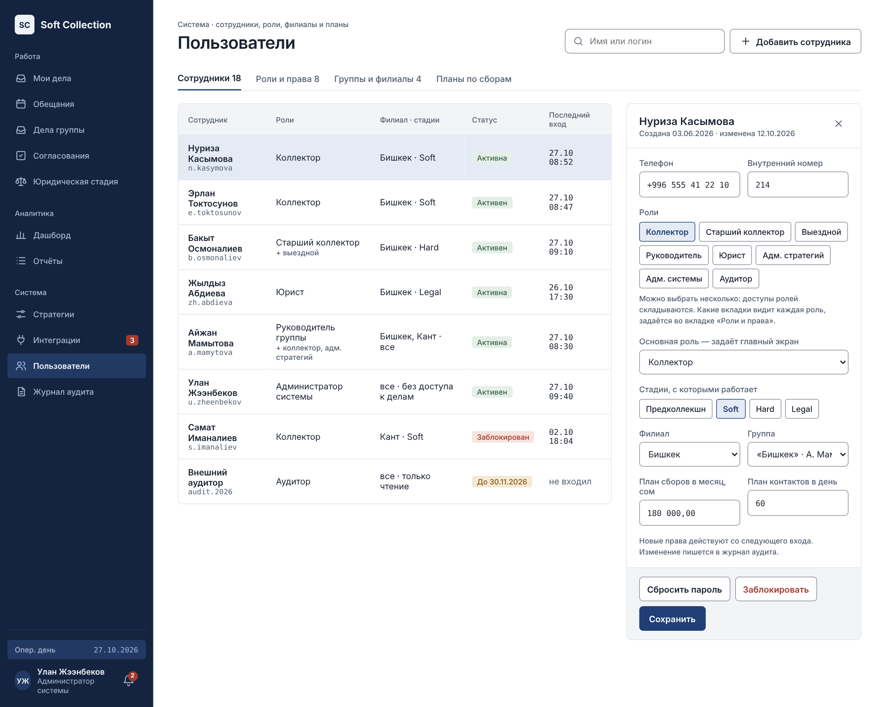

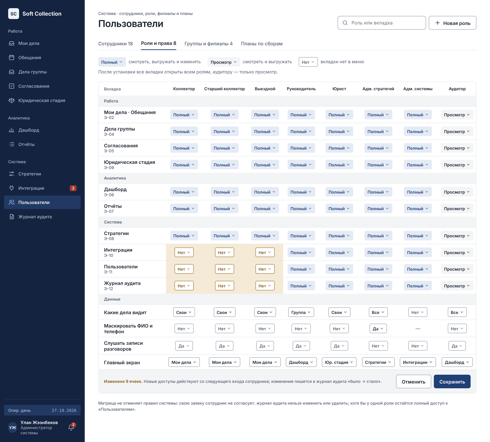

Администратор заводит сотрудников, выдаёт роли, филиалы и стадии, собирает группы и задаёт планы, а в матрице доступов решает, какие вкладки видит каждая роль. Отсюда же назначаются лимиты очереди и плана, которые видит коллектор на Э-02.

| Элемент                     | Поведение                                                                                                                                                                                                                                                                                                                                                                                        |
|-----------------------------|--------------------------------------------------------------------------------------------------------------------------------------------------------------------------------------------------------------------------------------------------------------------------------------------------------------------------------------------------------------------------------------------------|
| Поиск                       | По имени или логину                                                                                                                                                                                                                                                                                                                                                                              |
| Добавить сотрудника         | Открывает пустую панель справа; после сохранения сотрудник получает временный пароль по SMS                                                                                                                                                                                                                                                                                                      |
| Вкладки                     | Сотрудники; Роли и права (матрица доступов); Группы и филиалы; Планы по сборам на месяц                                                                                                                                                                                                                                                                                                          |
| Матрица доступов            | Строки — вкладки меню, столбцы — роли; в ячейке «Нет» (вкладки нет в меню), «Просмотр» (смотреть и выгружать) или «Полный» (ещё и менять). Ниже — какие дела видит роль (свои, группа, все, нет), маскировать ли ФИО и телефон, можно ли слушать записи разговоров, главный экран роли. «Новая роль» создаёт роль с нуля или копией существующей. Изменённые ячейки подсвечиваются до сохранения |
| Таблица сотрудников         | Имя и логин, роли, филиал и стадии, статус (активен, заблокирован, доступ до даты), последний вход; клик открывает панель                                                                                                                                                                                                                                                                        |
| Телефон, внутренний номер   | Телефон для кода входа и временного пароля; внутренний номер для IP-телефонии                                                                                                                                                                                                                                                                                                                    |
| Роли                        | Одна или несколько ролей из раздела 2 или созданных в матрице; одна из них основная — она задаёт главный экран. Доступы ролей складываются                                                                                                                                                                                                                                                       |
| Стадии                      | С какими стадиями работает сотрудник; от них зависят его очередь и права                                                                                                                                                                                                                                                                                                                         |
| Филиал, группа              | Видимость дел; группа задаёт руководителя и второго согласующего — он решает заявки, которые руководитель создал сам                                                                                                                                                                                                                                                                             |
| План сборов, план контактов | Цели на месяц и на день; показываются на Э-02 и Э-06                                                                                                                                                                                                                                                                                                                                             |
| Сбросить пароль             | Новый временный пароль по SMS, смена при входе обязательна                                                                                                                                                                                                                                                                                                                                       |
| Заблокировать               | Закрывает вход сразу, дела сотрудника попадают в «Без ответственного» на Э-04                                                                                                                                                                                                                                                                                                                    |
| Сохранить                   | Права действуют со следующего входа сотрудника                                                                                                                                                                                                                                                                                                                                                   |

**Проверки ввода**

- Логин уникален в организации; телефон — в формате +996 и 9 цифр.

- В организации всегда остаётся хотя бы один активный сотрудник с полным доступом к «Пользователям»: нельзя снять его роль, заблокировать его или закрыть эту вкладку его роли в матрице.

- Доступ аудитора всегда с датой окончания.

- Если у сотрудника несколько ролей, одна обязательно отмечена основной.

**Критерии приёмки**

- [ ] Сотрудника нельзя удалить, только заблокировать: его история сохраняется.

- [ ] При блокировке его дела сразу видны руководителю как «Без ответственного».

- [ ] Любое изменение ролей и прав пишется в журнал аудита с «было → стало».

- [ ] Сотрудник с ролями «Руководитель + Коллектор» после входа видит в меню пункты обеих ролей без повторов и открывается на главном экране основной роли.

- [ ] После установки в матрице все вкладки открыты всем ролям, аудитору — только просмотр.

- [ ] Вкладка, закрытая для всех ролей сотрудника, не показывается в меню, а прямая ссылка на неё открывает «Нет доступа».

- [ ] На вкладке с доступом «Просмотр» кнопок изменения нет.

### Э-12 Журнал аудита

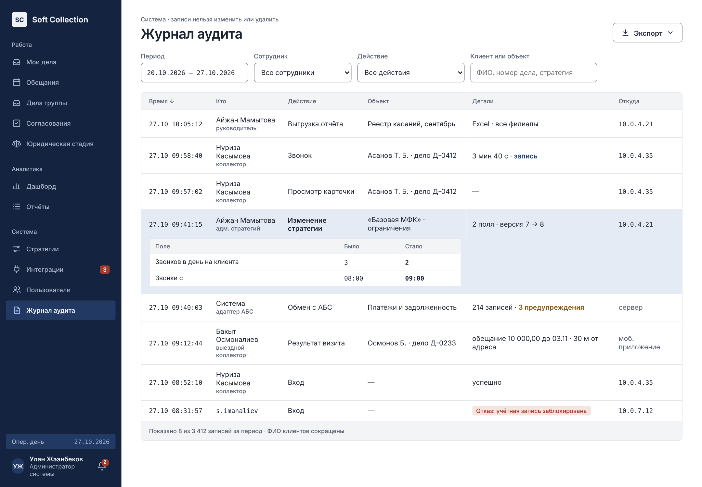

Кто, когда и что сделал в системе. Записи нельзя изменить или удалить ни одной ролью, включая администратора.

| Элемент                                        | Поведение                                                                                   |
|------------------------------------------------|---------------------------------------------------------------------------------------------|
| Экспорт                                        | Отфильтрованные записи в Excel или PDF; сама выгрузка тоже пишется в журнал                 |
| Период, Сотрудник, Действие, Клиент или объект | Фильтры; по умолчанию последние 7 дней                                                      |
| Строка журнала                                 | Время до секунды, сотрудник и роль, действие, объект, детали, IP или устройство             |
| Раскрытая строка                               | Для изменений — таблица «Поле, было, стало»                                                 |
| Ссылка «запись»                                | Проигрывает запись разговора; доступна ролям с правом «Слушать записи разговоров» в матрице |

**Что пишется в журнал:** вход и выход, просмотр карточки, прослушивание записи разговора, звонок, сообщение, результат контакта, обещание, переназначение, передача договора юристу, смена статуса договора в АБС (списан, долг прекращён), начало и конец периода просрочки, отметка «Не удалять», заявка и решение по ней, визит, изменение стратегии, шаблона, ограничений, пользователя, роли и матрицы доступов, подключения к АБС, выгрузка отчёта, каждый обмен с АБС. У каждой записи указана роль, по которой действие разрешено.

**Критерии приёмки**

- [ ] Записи журнала нельзя изменить или удалить через интерфейс и API.

- [ ] Поиск по журналу за месяц возвращает результат не дольше 5 секунд.

- [ ] ФИО клиентов в журнале сокращены до фамилии и инициалов.

- [ ] Если организация подключила SIEM (этап 3), каждая запись журнала уходит туда сразу после события; о сбое передачи администратор получает уведомление.

### Э-13 Страница должника по ссылке

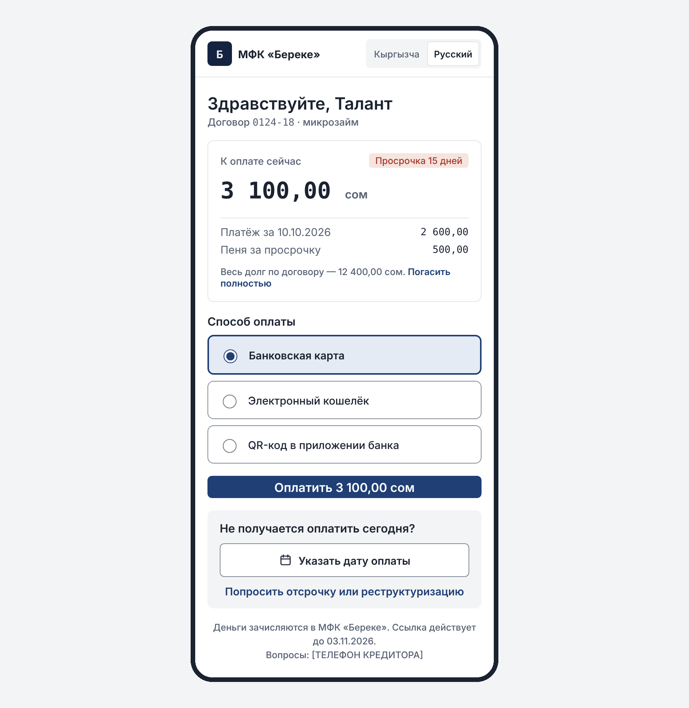

Должник открывает страницу по ссылке из SMS без входа и пароля. Задача — дать оплатить или договориться без звонка.

| Элемент                                 | Поведение                                                                                                                              |
|-----------------------------------------|----------------------------------------------------------------------------------------------------------------------------------------|
| Кыргызча, Русский                       | Язык страницы; по умолчанию — из анкеты клиента                                                                                        |
| Приветствие и договор                   | Только имя клиента и номера его договоров с просрочкой (договоры у юриста не показываются); других персональных данных на странице нет |
| К оплате сейчас                         | Просроченная сумма по каждому договору с разбивкой: пропущенный платёж и пеня; итог — отдельно по каждой валюте                        |
| Погасить полностью                      | Меняет сумму к оплате на весь долг по договору                                                                                         |
| Способ оплаты                           | Карта, электронный кошелёк, QR-код; набор зависит от сервисов, которые подключил кредитор                                              |
| Оплатить                                | Переход на страницу платёжного сервиса; деньги идут кредитору, модуль узнаёт об оплате из АБС и останавливает стратегию                |
| Указать дату оплаты                     | Дата и сумма создают обещание, как после звонка; до этой даты звонки не идут                                                           |
| Попросить отсрочку или реструктуризацию | Короткая форма с причиной; заявка попадает руководителю на Э-05                                                                        |
| Подвал                                  | Кому зачисляются деньги, срок действия ссылки, телефон кредитора                                                                       |

**Безопасность и состояния**

- Ссылка личная: случайный ключ не короче 32 символов, срок действия — 7 дней (настройка).

- Перед обещанием или заявкой — подтверждение кодом из SMS на номер клиента.

- Ссылка истекла — «Ссылка устарела» и телефон кредитора, без сумм и имени.

- После оплаты — «Платёж передан кредитору, долг обновится после обработки».

**Критерии приёмки**

- [ ] Страница открывается на смартфоне за 3 секунды при мобильном интернете.

- [ ] Устаревшая ссылка не показывает никаких данных клиента.

- [ ] Обещание со страницы останавливает звонки до своей даты и видно коллектору в истории контактов.

- [ ] Отчёт «Сборы за период» отделяет оплаты по странице от остальных.

## 7. Интеграция с АБС

Модуль никогда не работает со структурой АБС напрямую: адаптер переводит данные конкретной АБС в единую модель и обратно. Подключение нового клиента — это настройка или написание адаптера, ядро не меняется.

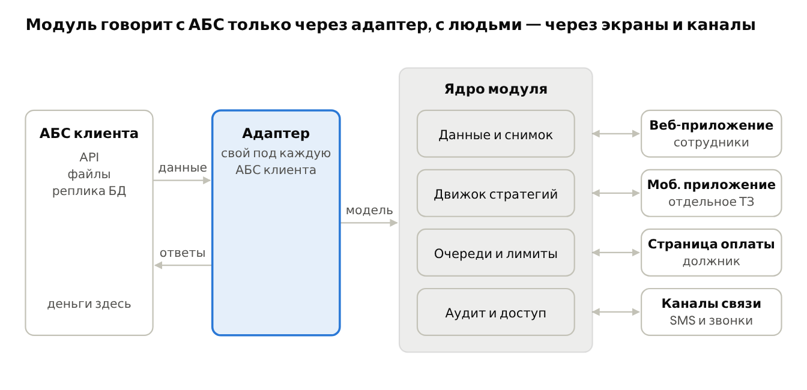

архитектура · АБС, адаптер, ядро, экраны и каналы

Деньги и проводки всегда остаются в АБС; обратно уходят только обещания, заявки и статусы дел.

### 7.1 Типы адаптеров

| Тип        | Когда подходит                                        | Свежесть данных                            | Что нужно от клиента                                |
|------------|-------------------------------------------------------|--------------------------------------------|-----------------------------------------------------|
| API        | АБС отдаёт данные по REST или SOAP                    | 5–15 минут или по событию                  | Адрес, ключ доступа, описание методов               |
| Файлы      | Старые и закрытые системы; CSV, XML или Excel по SFTP | Несколько раз в день, не реже раза в сутки | SFTP-папка, формат и расписание выгрузки            |
| Реплика БД | Нет API, но есть доступ к базе на чтение              | По расписанию, от 15 минут                 | SQL-представления и учётная запись только на чтение |

Обратно в АБС данные уходят тем же каналом: вызовом API, файлом в SFTP-папку или через API модуля, который АБС опрашивает сама.

### 7.2 Что нужно от любой АБС

| Сущность                    | Обязательные поля                                                                                                                                                | Желательные поля                                                    | Направление                 |
|-----------------------------|------------------------------------------------------------------------------------------------------------------------------------------------------------------|---------------------------------------------------------------------|-----------------------------|
| Клиент                      | ID в АБС, ФИО, ИНН (ПИН), хотя бы один телефон                                                                                                                   | Дата рождения, адреса, место работы, язык, согласие на каналы связи | АБС → модуль                |
| Договор                     | ID, ID клиента, номер, продукт, валюта, сумма, даты выдачи и погашения, филиал, статус (действует, закрыт, списан на внебаланс, долг прекращён) и дата его смены | Ставка, признак залога, кредитный специалист                        | АБС → модуль                |
| График                      | Договор, плановая дата, сумма платежа                                                                                                                            | Разбивка на основной долг и проценты                                | АБС → модуль                |
| Задолженность               | Договор, дата, просроченный и общий основной долг, проценты, пеня                                                                                                | Дни просрочки по данным АБС для сверки                              | АБС → модуль                |
| Платёж                      | ID, договор, дата и время, сумма, валюта                                                                                                                         | Канал оплаты                                                        | АБС → модуль                |
| Залог                       | Договор, тип, описание                                                                                                                                           | Оценка, место хранения                                              | АБС → модуль                |
| Поручитель, контактное лицо | Договор, ФИО, телефон, роль                                                                                                                                      | Адрес                                                               | АБС → модуль                |
| Обещание оплатить           | Договор, сумма, дата, сотрудник, канал                                                                                                                           | Комментарий                                                         | модуль → АБС                |
| Заявка                      | Договор, вид, срок, причина, кто одобрил                                                                                                                         | Расчёт модуля                                                       | модуль → АБС, ответ обратно |
| Статус дела                 | Договор, стадия, ответственный, статус дела (активно, пауза, неактивно)                                                                                          | Этап юридической стадии, номер периода просрочки                    | модуль → АБС                |

### 7.3 Правила обмена

- Порядок загрузки: клиенты → договоры → графики → задолженность → платежи → залоги и поручители.

- Каждая запись идентифицируется ID из АБС: повторная загрузка обновляет запись и не создаёт дублей.

- Одна ошибочная запись не останавливает обмен: она уходит в «Разобрать» на Э-10, а касания по связанному клиенту приостанавливаются.

- Платежи — как можно быстрее: через API по событию, при файлах — несколько раз в день; перед каждым касанием модуль смотрит свежие платежи.

- Исходящие данные в АБС стоят в очереди с повторами: до 5 попыток с растущим интервалом, дальше — ошибка в журнале обмена.

- Каждую ночь — сверка итоговой задолженности модуля с АБС по каждому договору; расхождение попадает в журнал обмена, верной считается АБС.

- Опер. день модуля = дата последней успешной загрузки задолженности.

- При подключении модуль загружает весь текущий портфель и платежи за последние 12 месяцев; история контактов из прежней системы переносится файлом, если клиент её даёт.

### 7.4 API модуля

Для АБС, которая умеет сама отправлять и забирать данные. Доступ — по ключу доступа, который выдаётся на Э-10, поверх HTTPS; схема — предложение, финализируется после выбора стека.

| Метод | Адрес                                   | Назначение                                                                               |
|-------|-----------------------------------------|------------------------------------------------------------------------------------------|
| POST  | /api/v1/import/{сущность}               | Пакетная загрузка: clients, contracts, schedules, debts, payments, collaterals, contacts |
| POST  | /api/v1/events/payment                  | Событие оплаты в момент проведения                                                       |
| GET   | /api/v1/export/promises?since=          | Новые и изменённые обещания                                                              |
| GET   | /api/v1/export/requests?status=approved | Одобренные заявки для проведения                                                         |
| POST  | /api/v1/requests/{id}/result            | Ответ АБС: проведена с новым графиком или отклонена с причиной                           |
| GET   | /api/v1/export/case-status?since=       | Стадии, статусы, ответственные, номера периодов и юридические этапы дел                  |

### 7.5 Каналы связи

Модуль сам не звонит и не отправляет сообщения: центр коммуникаций готовит касание — шаблон, время, лимиты, отказы клиента — и передаёт его провайдеру по API. Связь оплачивается отдельно от лицензии модуля.

| Канал                        | Что делает модуль                                                                                                                                       | Когда можно                                                                | Провайдер                                                                                                     |
|------------------------------|---------------------------------------------------------------------------------------------------------------------------------------------------------|----------------------------------------------------------------------------|---------------------------------------------------------------------------------------------------------------|
| SMS                          | Отправка по шаблону, статус доставки, стоимость                                                                                                         | Любая стадия, в разрешённые часы                                           | Местный SMS-агрегатор по API; имя отправителя — название организации, регистрируется у операторов             |
| Звонок коллектора            | Звонок в один клик из браузера, запись разговора, результат — в карточку                                                                                | Любая стадия, в разрешённые часы и в пределах лимитов                      | Телефонная станция модуля (Asterisk или FreeSWITCH) и SIP-канал оператора связи; у банка — его станция по SIP |
| Автообзвон и голосовой робот | Набирает список, проигрывает записанную фразу на кыргызском или русском с подставленными суммой и датой; ответившего соединяет со свободным коллектором | На шагах стратегии, где он включён (по умолчанию Soft), в разрешённые часы | Та же станция                                                                                                 |
| Платёжные сервисы            | Только переход с Э-13; деньги идут кредитору, факт оплаты модуль узнаёт из АБС                                                                          | —                                                                          | Те, что подключил кредитор                                                                                    |

Все отправки и звонки идут через один журнал коммуникаций: он считает лимиты контактов по клиенту независимо от канала, хранит стоимость каждого касания и отказы клиента от каналов.

**Кто платит за связь**

| Вариант       | Для кого                                | Как устроено                                                                                                                                                                                                                                                       |
|---------------|-----------------------------------------|--------------------------------------------------------------------------------------------------------------------------------------------------------------------------------------------------------------------------------------------------------------------|
| Свои договоры | Банки и крупные МФО                     | Организация сама заключает договоры с оператором связи и SMS-агрегатором и платит им напрямую; ключи доступа вводит на Э-10. Свою телефонную станцию банк подключает по SIP                                                                                        |
| Через нас     | МКК и МФК без своих договоров со связью | Договоры с провайдерами — у нас. Организация пополняет баланс связи, касания списываются по тарифу провайдера с наценкой. Когда баланс ниже порога, предупреждение получают сотрудники с полным доступом к «Интеграциям»; при нуле платные касания останавливаются |

В лицензию модуля входят звонок в один клик, запись разговоров, SMS по шаблонам и журнал коммуникаций. Автообзвон и голосовой робот включаются отдельной платной лицензией.

### 7.6 Стык с мобильным приложением

Само приложение выездного коллектора описывается отдельным ТЗ; здесь — только то, что веб-модуль должен ему дать и принять.

| Направление         | Данные                                                                                                                |
|---------------------|-----------------------------------------------------------------------------------------------------------------------|
| Модуль → приложение | Визиты на день: сотрудник, плановое время, адрес, долг, дни просрочки, телефоны; карточка клиента в объёме для выезда |
| Приложение → модуль | Начало и конец визита, геометка и расстояние до адреса, результат, обещание, фото, комментарий                        |

- Визит назначает руководитель на Э-04, старший коллектор из карточки (Э-03) или шаг стратегии; он хранится в сущности «Визит» (раздел 8).

- Результат визита попадает в историю контактов карточки, обещание — по правилам раздела 3.4 и дальше в АБС.

- Визиты учитываются в лимитах контактов клиента так же, как звонки.

- Протокол API и работа без связи — в ТЗ мобильного приложения.

**Макеты приложения.** Два экрана показывают, что модуль отдаёт приложению и что получает обратно; полное описание экранов — в ТЗ мобильного приложения.

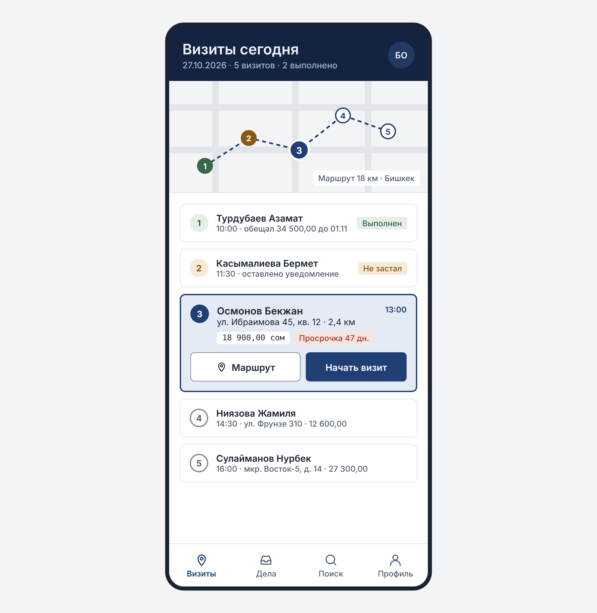

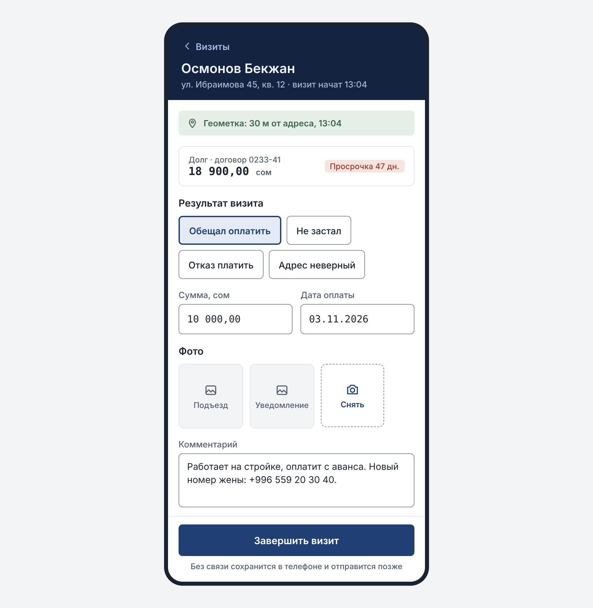

| Элемент              | Поведение                                                                                                                                                 |
|----------------------|-----------------------------------------------------------------------------------------------------------------------------------------------------------|
| М-1 · Визиты сегодня | Визиты на день по порядку маршрута: время, клиент, адрес, долг, дни просрочки; пройденные — со статусом «Выполнен» или «Не застал»; сверху карта маршрута |
| Маршрут              | Открывает навигатор до адреса клиента                                                                                                                     |
| Начать визит         | Открывает М-2, фиксирует время начала и геометку                                                                                                          |
| Геометка             | Расстояние до адреса из АБС и время; уходит в модуль вместе с результатом                                                                                 |
| Результат визита     | Обещал оплатить, Не застал, Отказ платить, Адрес неверный — по правилам раздела 3.3                                                                       |
| Сумма, дата оплаты   | Обязательны для «Обещал оплатить»; обещание уходит в модуль и дальше в АБС                                                                                |
| Фото, комментарий    | Фото подъезда или уведомления на двери; комментарий — новые сведения о клиенте                                                                            |
| Завершить визит      | Отправляет результат в модуль; без связи сохраняется в телефоне и уходит позже                                                                            |
| Нижнее меню          | Визиты, Дела, Поиск, Профиль — описываются в ТЗ приложения                                                                                                |

## 8. Модель данных

У модуля своя база на серверах организации; всё, что пришло из АБС, хранит ID записи в АБС. Одна установка обслуживает одну организацию. Ниже — основные сущности; поля типов и индексы уточняются при проектировании базы.

| Сущность             | Ключевые поля                                                                                                                                                                                               | Связи и правила                                                                                                  |
|----------------------|-------------------------------------------------------------------------------------------------------------------------------------------------------------------------------------------------------------|------------------------------------------------------------------------------------------------------------------|
| Организация          | Название, тип (банк, МКК, МФК), часовой пояс, лимиты контактов, календарь праздников                                                                                                                        | Корень всех данных; одна установка — одна организация                                                            |
| Филиал, группа       | Название; у группы — руководитель и второй согласующий                                                                                                                                                      | Пользователь входит в группу; дело принадлежит филиалу договора, по которому определена стадия дела (раздел 3.6) |
| Пользователь         | Логин, ФИО, телефон, внутренний номер, роли (одна основная), филиалы, стадии, планы, статус, доступ до                                                                                                      | Не удаляется, только блокируется                                                                                 |
| Роль                 | Название, доступ к каждой вкладке (нет, просмотр, полный), какие дела видит, маскирование, право слушать записи, главный экран                                                                              | Организация 1 → N ролей; пользователь N ↔ N ролей; изменения — в журнал аудита                                   |
| Клиент               | ID в АБС, ФИО, ИНН, дата рождения, язык, признак «только письменно»                                                                                                                                         | Телефоны (номер, статус, источник), адреса, место работы — отдельными строками                                   |
| Договор              | ID в АБС, номер, продукт, валюта, сумма, ставка, даты выдачи и погашения, филиал, статус в АБС и дата его смены                                                                                             | Клиент 1 → N договоров                                                                                           |
| Строка графика       | Дата, сумма, статус: оплачен, просрочен, предстоит                                                                                                                                                          | Договор 1 → N; при реструктуризации версия графика меняется                                                      |
| Снимок задолженности | Дата, основной долг (просроченный и всего), проценты, пеня, дни просрочки по модулю и по АБС                                                                                                                | Договор 1 → N, по одному на день — основа аналитики                                                              |
| Платёж               | ID в АБС, дата и время, сумма, валюта, канал, атрибуция (после звонка, SMS, страницы или без касания)                                                                                                       | Договор 1 → N                                                                                                    |
| Залог, поручитель    | Тип, описание, оценка; ФИО, телефон, роль                                                                                                                                                                   | Договор 1 → N                                                                                                    |
| Дело                 | Стадия, дни просрочки, статус (активно, пауза, неактивно) и причина паузы, номер текущего периода, ответственный, стратегия и её версия, вариант A/B, следующий шаг и его дата, метки, отметка «Не удалять» | Клиент 1 → 1 дело коллектора, не удаляется; в него входят договоры, которые не у юриста                          |
| Период просрочки     | Номер, начало, конец, максимум дней и стадия, ответственный, стратегия и версия, вариант A/B, собрано, итог (погашено, реструктуризация, договоры закрыты, долг прекращён)                                  | Дело 1 → N, открытый — один; основа отчётов и KPI                                                                |
| Стратегия            | Название, статус, порядок, сегмент, версия                                                                                                                                                                  | Версия 1 → N шагов; опубликованные версии не меняются                                                            |
| Шаг стратегии        | День или событие, канал, шаблон, время, очередь, роль; для перевода в Legal — режим передачи                                                                                                                | Принадлежит версии стратегии                                                                                     |
| Шаблон сообщения     | Канал, текст на русском и кыргызском, переменные                                                                                                                                                            | Используется шагами и ручными отправками                                                                         |
| Касание              | Канал, направление, кто (сотрудник или система), время, результат, комментарий, запись разговора, доставка, стоимость                                                                                       | Дело 1 → N, с номером периода; основа истории контактов и лимитов                                                |
| Обещание             | Договор, сумма, дата, статус, источник (звонок, визит, страница), время отправки в АБС                                                                                                                      | Дело 1 → N, с номером периода; действующее — одно                                                                |
| Заявка               | Вид, срок, причина, автор, источник, статус, решение и комментарий, ответ АБС                                                                                                                               | Дело 1 → N, с номером периода; открытая — одна                                                                   |
| Визит                | Сотрудник, плановое время, начало и конец, геометка, расстояние, результат, фото                                                                                                                            | Дело 1 → N                                                                                                       |
| Юридическое дело     | Этап, юрист, сумма требования, следующее действие и срок, кто передал и комментарий передачи                                                                                                                | Договор 1 → 1; события и документы — отдельными строками                                                         |
| Ссылка оплаты        | Хэш ключа, срок действия, открыта ли, создано ли обещание                                                                                                                                                   | Дело 1 → N                                                                                                       |
| Подключение к АБС    | Тип адаптера, параметры (секреты — зашифрованы), расписание, сопоставление полей                                                                                                                            | Одно на установку                                                                                                |
| Сеанс обмена         | Время, направление, сущность, записей, ошибок, проблемные записи                                                                                                                                            | Подключение 1 → N                                                                                                |
| Запись аудита        | Время, пользователь, роль, действие, объект, было и стало, IP или устройство                                                                                                                                | Только добавление, без изменения и удаления                                                                      |

## 9. Нефункциональные требования

Целевые значения — предложение команды; их утверждают вместе с этим ТЗ, а нормы по персональным данным и срокам хранения сверяют с юристом.

| Требование                                    | Значение                                                                                                                                                                                                                                                                                           |
|-----------------------------------------------|----------------------------------------------------------------------------------------------------------------------------------------------------------------------------------------------------------------------------------------------------------------------------------------------------|
| Доступность                                   | 99,5% в рабочие часы организации при серверах по нашим требованиям; требования к серверам передаём при внедрении                                                                                                                                                                                   |
| Открытие краткой карточки и карточки должника | до 2 секунд                                                                                                                                                                                                                                                                                        |
| Поиск, переключение очереди                   | до 1 секунды                                                                                                                                                                                                                                                                                       |
| Портфель одной организации                    | до 500 000 договоров без потери скорости                                                                                                                                                                                                                                                           |
| Свежесть данных АБС                           | API — минуты, файлы — не реже раза в сутки                                                                                                                                                                                                                                                         |
| Резервное копирование                         | Ежедневно, хранение 30 дней, восстановление — до 4 часов; настраивается на серверах организации при внедрении                                                                                                                                                                                      |
| Сеть                                          | Модуль работает во внутренней сети организации. Из интернета доступны только страница должника и API мобильного приложения — через периметр организации (DMZ); серверу нужен выход к SMS-агрегатору и оператору связи                                                                              |
| Хранение данных                               | На серверах организации на территории КР                                                                                                                                                                                                                                                           |
| Шифрование                                    | HTTPS для всего трафика; ИНН, телефоны, адреса и записи разговоров — зашифрованы в базе; пароли — только хэш                                                                                                                                                                                       |
| Доступ                                        | Матрица доступов (роль × вкладка), какие дела видит роль, филиалы и стадии сотрудника; маскирование персональных данных; вход по коду из SMS по настройке; вход через Active Directory / LDAP — этап 3                                                                                             |
| Аудит                                         | Журнал всех действий, без изменения и удаления; сроки хранения журнала, дел и записей разговоров — раздел 4.5 (значения сверяют с юристом); передача журнала в SIEM организации по syslog — этап 3                                                                                                 |
| Языки и форматы                               | Кыргызский и русский; даты ДД.ММ.ГГГГ; суммы в сомах и долларах раздельно                                                                                                                                                                                                                          |
| Браузеры                                      | Две последние версии Chrome, Edge, Firefox, Safari; ширина от 1024 px                                                                                                                                                                                                                              |
| Страница должника                             | До 3 секунд на мобильном интернете, без входа и установки                                                                                                                                                                                                                                          |
| Поставка                                      | Установка у клиента из сборки в контейнерах; два контура — тестовый и рабочий. Новую версию от нас сначала ставят на тестовый контур, затем на рабочий; изменения структуры базы применяются автоматически, перед обновлением делается резервная копия базы, при сбое — откат на предыдущую версию |
| Мониторинг                                    | Метрики работы; об ошибках обмена с АБС и отказах каналов связи оповещается администратор организации, а при доступе для поддержки — и наша команда                                                                                                                                                |

## 10. Этапы реализации и приёмка

Пилот — через 3–4 месяца после утверждения ТЗ, у первого клиента — МКК, МФК или банка. Сроки — оценка для 3–4 разработчиков; переход к следующему этапу — только когда предыдущий работает у реального клиента.

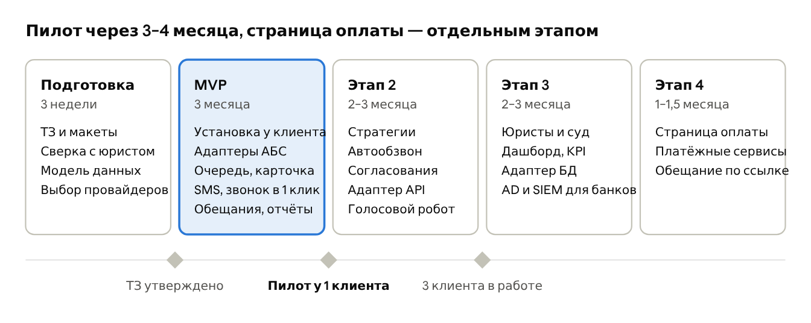

план разработки · 5 этапов, 3 контрольные точки

Этап 4 можно поставить раньше, если оплата по ссылке нужна пилотному клиенту. Мобильное приложение выездного коллектора планируется отдельно.

| Этап   | Экраны                                                                 | Что входит                                                                                                                                                                                                                                             | Критерий завершения                                                               |
|--------|------------------------------------------------------------------------|--------------------------------------------------------------------------------------------------------------------------------------------------------------------------------------------------------------------------------------------------------|-----------------------------------------------------------------------------------|
| MVP    | Э-01, Э-02, Э-03, Э-04, Э-07, Э-10, Э-11, Э-12; Э-06 и Э-08 — частично | Установка на серверы пилотного клиента, адаптер файлов и адаптер под его АБС, стадии по дням, очереди, SMS по шаблонам, звонок в один клик через телефонную станцию модуля с записью разговора, обещания, ограничения контактов, базовые отчёты, аудит | Пилотный клиент месяц работает с просрочкой только в модуле; суммы сходятся с АБС |
| Этап 2 | Э-05, Э-08 полностью                                                   | Конструктор стратегий и A/B-тест, автообзвон и голосовой робот, реструктуризация, адаптер API                                                                                                                                                          | Два новых клиента подключены без доработки ядра                                   |
| Этап 3 | Э-06, Э-09                                                             | Юридическая стадия, дашборд и KPI, адаптер реплики БД; для банков — вход через Active Directory / LDAP и передача журнала аудита в SIEM                                                                                                                | Три клиента в работе                                                              |
| Этап 4 | Э-13                                                                   | Страница оплаты с платёжными сервисами                                                                                                                                                                                                                 | Часть оплат пилота приходит по ссылке                                             |

В MVP Э-08 уже есть, но только частично: ограничения контактов, шаблоны и фиксированные стадии по дням, без конструктора шагов. Э-06 в MVP — портфель по стадиям и сборы, без переходов и планов. Чего в MVP ещё нет, того нет и на экранах: кнопки заявки на реструктуризацию появляются вместе с Э-05 на этапе 2, автообзвон и голосовой робот — тоже на этапе 2; «Передать юристу» — вместе с Э-09 на этапе 3, а до этого договоры после порога Legal остаются на Hard с меткой «Можно передать юристу»; ссылка на оплату в SMS — вместе с Э-13 на этапе 4.

**Общие критерии приёмки каждого этапа**

- [ ] Все критерии экранов этапа из раздела 6 проверены на данных пилота.

- [ ] Суммы во всех экранах совпадают с АБС на дату обмена.

- [ ] Нефункциональные требования раздела 9 для вошедших функций выполнены.

- [ ] Интерфейс и шаблоны доступны на кыргызском и русском.

- [ ] Пользовательская инструкция для ролей этапа готова.

## 11. Открытые вопросы

Их нужно закрыть до старта MVP: от ответов зависят адаптеры, стек и сроки.

- [ ] Кто пилотный клиент и какая у него АБС?

- [ ] Кто первый клиент — банк или МКК/МФК — и какие у него требования к серверам: ОС, СУБД, доступ нашей команды для обновлений и поддержки?

- [ ] Какой стек: Java/Spring или Python/Django, PostgreSQL, React, Docker?

- [ ] Какой SMS-агрегатор и оператор связи для SIP-канала и какие у них тарифы? SIP-канал нужен уже для MVP.

- [ ] Нужна ли лицензия на услуги связи, если SMS и минуты продаём через баланс в модуле, или работаем агентом провайдера?

- [ ] Какие требования НБКР и законов КР действуют к взысканию, часам и частоте контактов, уведомлению о записи разговора и срокам хранения записей?

- [ ] Какие платёжные сервисы подключаем для страницы оплаты?

## Источники

- [Soft Collection — концепт модуля](https://claude.ai/artifact/LSPDLTvY7bm4nctk7R2a58)

- [Soft Collection — макеты интерфейса](https://claude.ai/artifact/Lhkz9LeumcVWEr44bLCGQZ)

- [Штрафы за нарушения при обработке персональных данных — economist.kg, 13.10.2026](https://economist.kg/vlast/2026/10/13/personalnye-dannye-shtrafy-140-tys-2/)

- [Kyrgyzstan: understanding and complying with personal data laws — ICNL](https://www.icnl.org/post/news/kyrgyzstan-understanding-and-complying-with-personal-data-laws)

- [WhatsApp Business Messaging Policy](https://business.whatsapp.com/policy)
